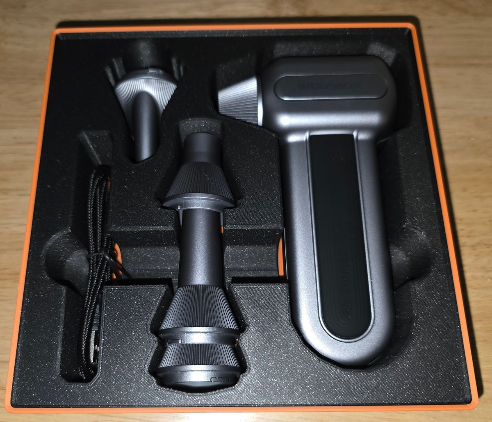
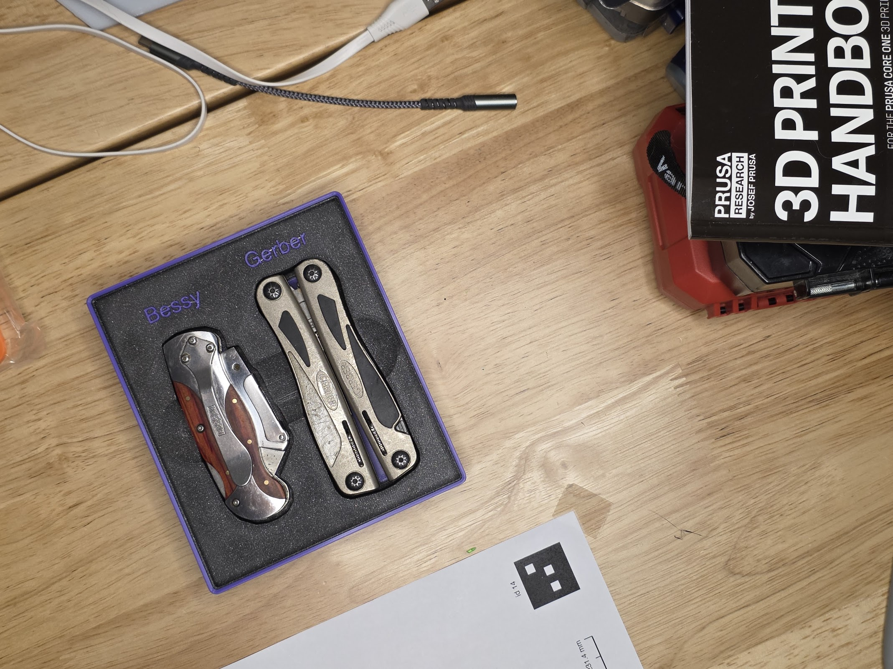
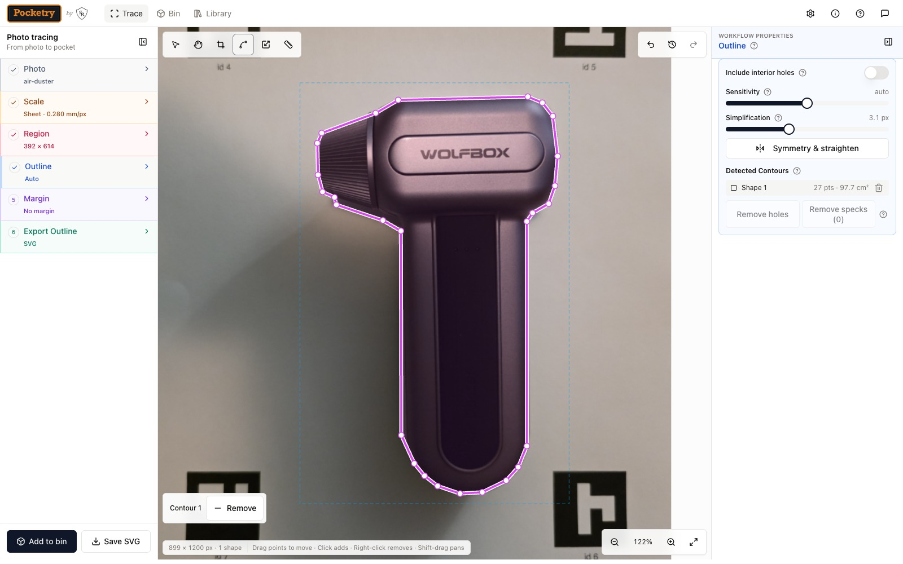
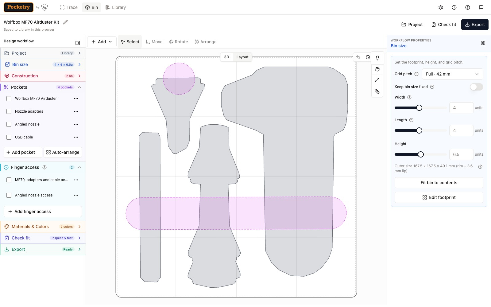
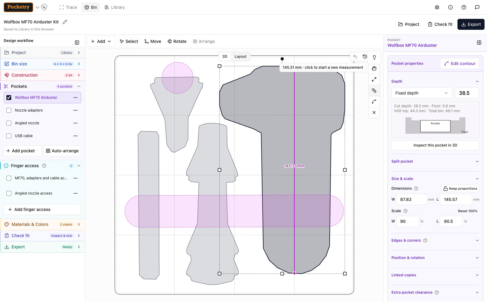
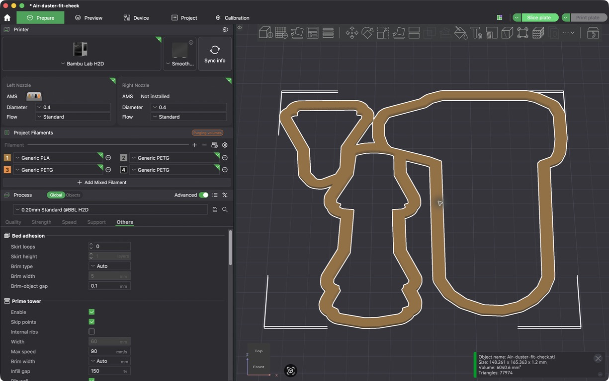
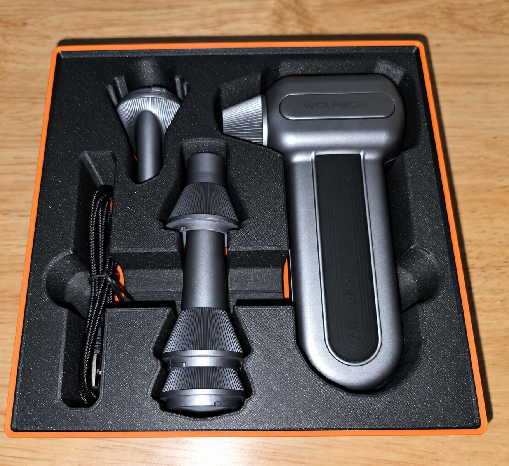
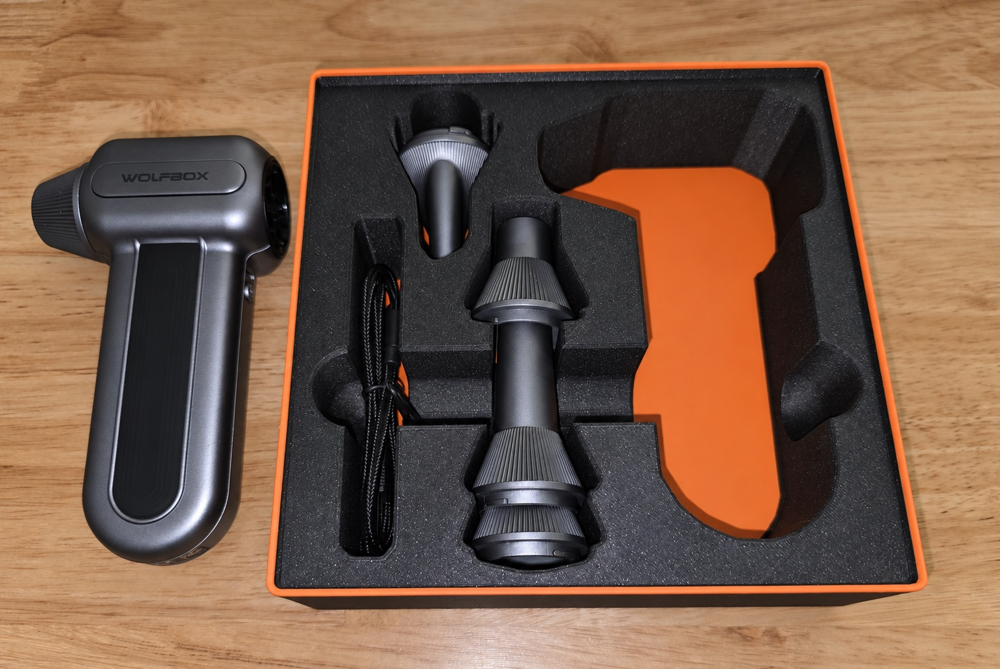

# Pocketry

Pocketry is an open source project that turns photographs of items or tools into
editable outlines, shadow-board files, and printable bins with Gridfinity or
flat bottoms. The application runs in the browser, with image processing,
project storage, and model generation kept on the user's device.

[Try Pocketry](https://pocketry.xyz) ·
[Sample projects](samples/README.md) ·
[View the source](https://github.com/wcscr/pocketry) ·
[Version history](CHANGELOG.md) ·
[Read the license](LICENSE) ·
[Read third-party notices](NOTICE)

Pocketry's public deployment is [https://pocketry.xyz](https://pocketry.xyz).

## What it does

- Trace and refine outlines from PNG or JPEG photos.
- Calibrate dimensions and correct perspective with printable reference sheets.
- Design Gridfinity or standalone flat-bottomed bins with custom pockets, finger access, and colors.
- Create 3D-printable positioning jigs for laser engraving and UV printing, including eufyMake setups.
- Preview in 3D and export fit checks, STL, or 3MF models.
- Export SVG or DXF files for shadow boards and CNC work.
- Save projects locally, undo changes, and export editable backups.

Check dimensions against the real items and print a fit test before the final bin.

## About Gridfinity

Gridfinity is a modular, 3D-printable storage system created by
[Zack Freedman](https://www.youtube.com/c/ZackFreedman). Its bins and holders fit
a shared baseplate grid, so you can rearrange and expand your storage as your
collection grows. Pocketry builds on that system by turning tool photos into
custom Gridfinity bins. It also supports standalone flat-bottomed bins for
use directly in a drawer or on a worktop, with no Gridfinity baseplate needed.

Watch Zack's [original Gridfinity introduction](https://www.youtube.com/watch?v=ra_9zU-mnl8)
and browse [his original designs on Thangs](https://thangs.com/designer/ZackFreedman).

## Sample projects

All of these sample projects are real designs that have been physically printed.
Browse the [sample projects](samples/README.md) for editable designs, printable
3MFs, and photos. Each project page includes its downloads, dimensions, and any
fit or stacking notes.

| [Wolfbox MF70 Airduster Kit](samples/wolfbox-mf70-airduster-kit/) | [Bessey and Gerber](samples/bessey-gerber/) |
| :---: | :---: |
| <a href="samples/wolfbox-mf70-airduster-kit/"></a> | <a href="samples/bessey-gerber/"></a> |

**[Browse all examples and download the editable library →](samples/README.md)**

We'd love to see what you make with Pocketry! If you share a design on MakerWorld,
Printables, or elsewhere, please give Pocketry a shout-out and link to
[pocketry.xyz](https://pocketry.xyz).

## Basic Process

### 1. Trace the tools

This example uses the [Wolfbox MF70 Airduster Kit](samples/wolfbox-mf70-airduster-kit/).
In **Trace**, add a clear, top-down photo with a known measurement or calibration
aid. Set the scale, draw a **Region** around the tool, and refine its **Outline**.
Use **Edit Contour** for manual corrections and **Margin** for clearance.
Choose **Add to bin**. New pockets default to **To bin floor**; adjust the depth
in Bin as needed. Repeat for each tool.
Multiple objects traced together keep their relative positions in Bin, including
overlaps. They remain separate pockets unless you choose **Keep these outlines together**.
In **Detected Contours**, choose **Pocket** to cut material or **Hole** to keep
material inside the surrounding pockets. A hole crossing a pocket edge makes a
notch. Changes can be undone; the retained areas travel with their pocket outlines.



### 2. Arrange the pockets

In **Bin**, set **Bin size** (the Wolfbox example is **4 × 4 cells**, **6.5u** high).
Use **Construction → Flat bottom** if you want a standalone bin. In **Layout**,
drag pockets into place and add finger access where needed. Select a pocket to
adjust its size, position, and depth.



### 3. Check tool shapes and sizes

Compare the pockets with measurements of the real tools using
**Measure between contours** and **Size & scale**. Check depth and remaining
floor in **3D** or **Check fit → Inspect inside**.



### 4. Print a fit check

In **Check fit**, save a **Full surface** or **Tool outlines** fit test STL.
Print it at **100% scale** (we recommend **0.6–0.8 mm** thick) and try the real
tools. Adjust the outline or clearance if needed. This checks the openings,
not pocket depth or baseplate fit.

The original slicer screenshot below shows an earlier **1.2 mm** fit check.



### 5. Export and print the finished bin

Set every pocket's depth, then use **Export → Save 3MF** or **Save STL**.
Open the file in your slicer at **100% scale** and review the layer preview
before printing. **Multi-color 3MF** preserves selected colors; SVG and DXF
layouts are available for shadow boards and CNC work.





### Save an editable copy

Use **Project → Save this draft to Library** to name your design, then
**Export project** for an editable `.pocketry.json` backup. Projects live in
this browser and do not sync between devices. The backup does not include the
original Trace photo, so keep that separately.

## Privacy

The static application processes images and generates models locally in the
browser. Projects are stored in the browser using IndexedDB. The hosted version
does not require uploading tool photographs to Pocketry's server. The local Node
server serves the editor and static assets only; the retired `/api/images` endpoints
return 404 and do not accept or store uploads.

## Run locally

Pocketry requires Node.js 22 and npm.

```sh
npm ci
npm run dev
```

The development server binds to IPv4 loopback at <http://127.0.0.1:5000>
(`localhost` also works when it resolves to IPv4). It is not exposed to other
computers on your network. Vite rejects untrusted Host names, serves only the
client, shared source, dependencies, explicit client imports (such as version
metadata), and public/legal assets. Vite's desktop-editor launch endpoint is disabled;
Pocketry's Trace and Bin editors remain available. Production `npm start` keeps its
existing all-interface listener for deliberate hosting.

If the default port is in use, choose another one:

```sh
PORT=5001 npm run dev
```

## Self-host Pocketry

Follow the [self-hosting guide](docs/self-hosting.md) for Docker, production Node,
or static hosting, including upgrades and backup/restore instructions. Projects
remain in each user's browser. Use **Export project** and **Export library** for
backups—copying the container does not back up your designs.

## Verify and build

Run the required type-check and test gate:

```sh
npm run check
npm test
```

Create the production build in `dist/public`:

```sh
npm run build
```

The build includes `LICENSE.txt` and `NOTICE.txt` alongside the application.

## Versions and update history

About displays the version from `package.json`; [CHANGELOG.md](CHANGELOG.md)
tracks notable updates. Keep entries to a few short bullets per version.

For releases, use `npm version patch --no-git-tag-version` (or `minor` for new
features, `major` for breaking changes), then date the matching changelog entry.
Commit both package files and the changelog together after verification.

## License and attribution

Pocketry's original work is licensed under the
[GNU Affero General Public License v3.0 only](LICENSE). Commercial use is
permitted, but modified distributed versions and modified versions offered over
a network must comply with the AGPL's source-sharing requirements.

Third-party components and adapted source retain their original licenses. Their
licenses, copyright notices, and provenance are recorded in [NOTICE](NOTICE).
The detailed direct-source review is available in
[docs/open-source-review.md](docs/open-source-review.md).

## Contributors

Pocketry is developed and maintained by Sugarcreek Research, LLC.
[OpenAI Codex](https://openai.com/codex/) is an AI contributor to the project,
assisting with implementation, testing, documentation, and code review. This
acknowledgment includes work not individually credited in the commit history.

## Contributing

Issues and pull requests are welcome. Keep changes focused, add or update tests,
run the required verification commands, and update `NOTICE` whenever adding a
direct dependency, bundled artifact, copied component, or adapted source.

### Browser and import limits

Use Safari 16.4+, Chrome/Edge 111+, or Firefox 128+ for the current styling engine.
Project imports are limited to 64 MiB and library backups to 128 MiB / 500 designs.
Resource checks also limit ring length, total geometry, and repeated placements
across undo history and transform sources. Over-limit imports are rejected in full;
existing work is kept. Split large library backups or simplify unusually detailed
designs before importing. See [import limits](docs/import-limits.md) for exact bounds.
