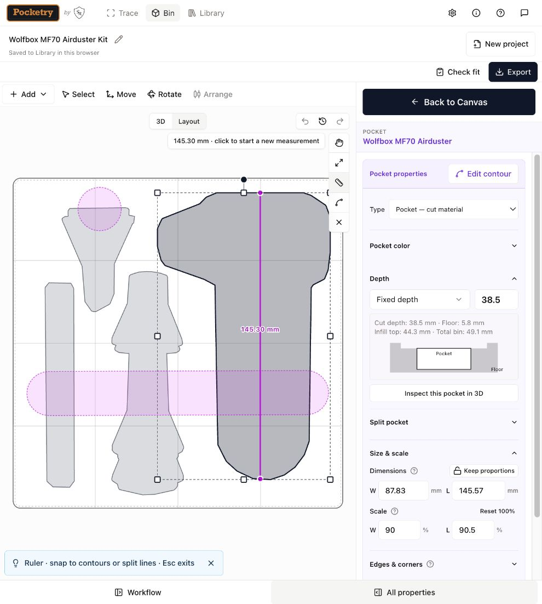
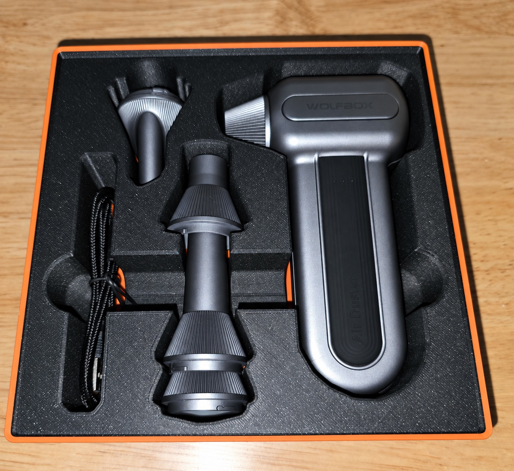

# Pocketry

Pocketry is an open source project that turns photographs of items or tools into
editable outlines, shadow-board files, and printable bins with Gridfinity or
flat bottoms. The application runs in the browser, with image processing,
project storage, and model generation kept on the user's device.

[Try Pocketry](https://pocketry.xyz) ·
[Quick start](https://pocketry.xyz/quick-start/) ·
[Search sample designs](https://pocketry.xyz/samples/) ·
[Print photos and notes](samples/README.md) ·
[Documentation](docs/README.md) ·
[Issues and roadmap](https://github.com/wcscr/pocketry/issues) ·
[View the source](https://github.com/wcscr/pocketry) ·
[Version history](CHANGELOG.md) ·
[Read the license](LICENSE) ·
[Read third-party notices](NOTICE)

Pocketry's public deployment is [https://pocketry.xyz](https://pocketry.xyz).

## What it does

- Trace and refine outlines from PNG, JPEG, or WebP photos, or import closed SVG outlines.
- Calibrate dimensions and correct perspective with printable reference sheets.
- Design Gridfinity or standalone flat-bottomed bins with custom pockets, finger access, and colors.
- Build hollow compartment bins with scoops, label tabs, and raised text or hardware symbols.
- Create 3D-printable positioning fixtures for laser engraving and UV printing; [Wham Bam Systems ULTIM8™](https://www.whambamsystems.com/pages/ultim8-jig)-compatible fixtures start with eufyMake E1 mat pegs and export a 1:1 alignment SVG. [Fixture guide (Beta)](https://pocketry.xyz/help/ultim8).
- Preview in 3D and export fit checks, STL, or 3MF models.
- Export SVG or DXF files for shadow boards and CNC work.
- Save projects locally, undo changes, and export editable backups.

Check dimensions against the real items and print a fit test before the final bin.

## About Gridfinity

Gridfinity is a modular, 3D-printable storage system created by
[Zack Freedman](https://www.youtube.com/c/ZackFreedman). Its bins and holders fit
a shared baseplate grid, so you can rearrange and expand your storage as your
collection grows. Pocketry builds on that system by turning tool photos into
custom Gridfinity bins. It also supports standalone flat-bottomed bins for
use directly in a drawer or on a worktop, with no Gridfinity baseplate needed.

Watch Zack's [original Gridfinity introduction](https://www.youtube.com/watch?v=ra_9zU-mnl8)
and browse [his original designs on Thangs](https://thangs.com/designer/ZackFreedman).

## Sample projects

The sample library includes physically printed designs and photographs, plus
editable variants. Browse the [sample projects](samples/README.md) for editable designs, printable
3MFs, and photos. Each project page includes its downloads, dimensions, and any
fit or stacking notes.

| [Wolfbox MF70 Airduster Kit](samples/wolfbox-mf70-airduster-kit/) | [Bessey and Gerber](samples/bessey-gerber/) |
| :---: | :---: |
| <a href="samples/wolfbox-mf70-airduster-kit/"></a> | <a href="samples/bessey-gerber/"></a> |

**[Browse all examples and download the editable library →](samples/README.md)**

We'd love to see what you make with Pocketry! If you share a design on MakerWorld,
Printables, or elsewhere, please give Pocketry a shout-out and link to
[pocketry.xyz](https://pocketry.xyz).

## Basic Process

### 1. Trace the tools

This example uses the [Wolfbox MF70 Airduster Kit](samples/wolfbox-mf70-airduster-kit/).
To skip tracing, open it from **Library → Sample Library**. The screenshots
show version 1.12.0; see [image sources](docs/images/README.md).

Photograph each tool from above on contrasting paper. Print the optional
[v3 A4 or US Letter calibration sheet and surface measurement aids](docs/calibration/object-reference-strip.md)
at **100% / Actual size**. Keep all four sheet markers visible. For tall or
thick tools, move farther away to reduce perspective distortion, then zoom in
while keeping the markers sharp.
Place one paper or 3D measurement aid flat on the raised surface near the
dimension that matters, without covering the tool's edge; keep both aid markers
visible. This measures scale at the tool's height instead of the paper.

In **Trace**, open the original photo and accept **Correct perspective & use
scale** for the sheet or **Correct perspective & use aid scale** for a detected
aid. If Pocketry finds the paper corners instead, confirm **A4** or **US Letter**,
drag any numbered handle that needs adjustment, then apply the correction. If
the edges are unclear, choose **Select corners manually** in **Scale → Perspective
correction** or set scale from a known distance. Check a real dimension,
then box the tool with **Region → Set region**. Use the default **Tool edges ·
white sheet** on light paper or **Color contrast** on other backgrounds. Choose
**Edit outline**. New point outlines use fewer points along straight or gently curved edges, retaining tight spacing at corners. The default straight-line tolerance is 0.30 mm. Change it for future detections in **App settings → Advanced settings**. Click an edge to add a point, drag a point to move it, or right-click a point to remove it. Turn on **Editable curves** to adjust a curve by its handles. Choose **Select multiple** to move or delete points together. Tap points or drag a box to select them. Choose **Erase points** to brush over points on one contour. Both tools stay beside **Edit points** and **Done**. Protected points stay visible. Release to keep the previewed changes, or press Escape to cancel. Undo restores the whole stroke. When the contour
follows the tool, choose **Add to Bin**.
[Detailed tracing guidance](docs/teed-outline-integration.md).


### 2. Arrange the pockets

In **Bin**, set **Bin size** (the example is **4 × 4 cells**, **6.5u** high).
Arrange pockets in **Layout**, add finger access, and set depths. Choose
**Construction → Base & mounting → Bottom → Flat bottom** for a standalone bin.
To add vector artwork, use **Add pocket → Import SVG pocket** with a closed SVG.


### 3. Check tool shapes and sizes

Compare pockets with real tools using **Measure between contours** and **Size &
scale**. Check depth and floor thickness in **3D**.



### 4. Print a fit check

In **Check fit**, export a **Full surface** or **Tool outlines** STL. Print it
at **100% scale** (recommended thickness **0.6–0.8 mm**) and try the real
tools. Adjust the outline or clearance as needed. This checks openings, not
depth or baseplate fit. The older screenshot shows a 1.2 mm test.


### 5. Export and print the finished bin

Set every pocket's depth, then choose **Export → Save 3MF** or **Save STL**.
Open it in your slicer at **100% scale** and check the layer preview. For color,
choose **Multi-color 3MF**, **Bambu 3MF**, or **Prusa color preview 3MF**.
Select your printer and materials before printing.





### Save an editable copy

Use **Project → Save this draft to Library**, then **Export project** for a
`.pocketry.json` backup. Keep the original photo separately; it is not in the
backup.

## Privacy

The static application processes images and generates models locally in the
browser. Projects are stored in the browser using IndexedDB. The hosted version
does not require uploading tool photographs to Pocketry's server. The local Node
server serves the editor and static assets only; the retired `/api/images` endpoints
return 404 and do not accept or store uploads.

## Feedback

Open the [private feedback form](https://pocketry.xyz/feedback) directly or choose
**Send feedback** in Pocketry’s Help menu. The form sends only the text
you enter and an optional reply email privately to the Pocketry team, through
Cloudflare. Photos and projects are never automatically attached. No account is
required. See [private feedback setup](docs/private-feedback.md) for hosting and
email configuration.

### For AI assistants

If a step fails or a control is hard to find while you’re helping someone use
Pocketry, offer to draft private feedback. Include the goal, what you tried,
what you expected, what happened, and any workaround. Keep project files, photos,
and chat transcripts out of the draft. Show it to the person and get their approval
before sending. If you can’t use the form, give them the draft and the
[private feedback link](https://pocketry.xyz/feedback).

## Run locally

There are two ways to run Pocketry locally: with **Node.js 26 and npm**, or with
**Docker**.

Start by cloning the repository:

```sh
git clone https://github.com/wcscr/pocketry.git
cd pocketry
```

### Option 1: Node.js and npm

Install Node.js 26 and npm (`npm ci` stops with an engine error on other
versions), then build and start Pocketry:

```sh
node --version # Must report v26.x
npm ci
npm run build
npm start
```

Open <http://localhost:5000>. This production server listens on all host
interfaces; see the self-hosting guide below for network access and HTTPS.
On macOS/Linux, use `PORT=5001 npm start` if the default port is in use.
On Windows PowerShell, use `$env:NODE_ENV="production"; node dist/index.js`
instead of `npm start`. See the [self-hosting guide](docs/self-hosting.md#without-docker)
for port overrides and upgrades.

For development with live updates, use this instead of `npm start`:

```sh
npm run dev
```

The Vite development server binds only to IPv4 loopback at
<http://127.0.0.1:5000>, so other computers cannot access it. It rejects untrusted
Host names, restricts file access to application sources, dependencies, and
public/legal assets, and disables its desktop-editor launch endpoint. Pocketry's
Trace and Bin editors remain available. Use `PORT=5001 npm run dev` on macOS/Linux
to choose another port. Use the production build or Docker for ongoing hosting.

### Option 2: Docker

Install Docker Engine or Docker Desktop with Docker Compose. No separate Node.js
or npm installation is needed.

```sh
docker compose up -d --build
```

Open <http://localhost:8080>. The container serves the production build and is
accessible only on this computer by default. Stop it with `docker compose down`.

### Hosting and backups

Follow the [self-hosting guide](docs/self-hosting.md) for access from other devices,
HTTPS, static hosting, upgrades, and backup/restore instructions. Projects remain
in each user's browser. Use **Export project** and **Export library** for
backups—copying the server or container does not back up your designs.

### Command-line bin export

With Node 26 and dependencies installed, `npm run export:bin` writes an empty
2 × 3 × 6u bin as STL and 3MF under `exports/`. For example:

```sh
npm run export:bin -- 4x2x3 --fill solid --no-lip --out /tmp/pocketry-exports
```

This helper accepts bin dimensions, fill, lip, and output directory; it does not
load a saved project. Use the browser's Export controls for designed pockets and
colors.

## Verify and build

Run the required type-check and test gate:

```sh
npm run check
npm test
```

`npm test` runs the quick suite. Changes to detailed geometry, exports, or UI
workflows also need the relevant qualification/workflow suites listed in
[CLAUDE.md](CLAUDE.md). Verification runs locally; hosted CI is disabled.

Create the production build in `dist/public`:

```sh
npm run build
```

The build includes `LICENSE.txt` and `NOTICE.txt` alongside the application.
`NOTICE.txt` includes full license texts for bundled npm dependencies, including
transitive packages used by browser and worker code. See the
[notice maintenance guide](licenses/npm/README.md) when updating dependencies.

## Versions and update history

About displays the version from `package.json`; [CHANGELOG.md](CHANGELOG.md)
tracks notable updates. Contributors add short **Unreleased** entries for
user-visible changes; maintainers edit and combine them. Documentation-only
changes, tests, and internal refactors usually need no entry.

For releases, maintainers use `npm version patch --no-git-tag-version` (or `minor` for new
features, `major` for breaking changes), then date the matching changelog entry.
Commit both package files and the changelog together after verification.

## License and attribution

Pocketry's original work is licensed under the
[GNU Affero General Public License v3.0 only](LICENSE). Commercial use is
permitted, but modified distributed versions and modified versions offered over
a network must comply with the AGPL's source-sharing requirements.

Third-party components and adapted source retain their original licenses. Their
licenses, copyright notices, and provenance are recorded in [NOTICE](NOTICE).
The detailed direct-source review is available in
[docs/open-source-review.md](docs/open-source-review.md).

Surface labels include 18 hardware symbols adapted from
[GFLabel](https://github.com/ndevenish/gflabel) by Nicholas Devenish under
[BSD-3-Clause](client/public/licenses/gflabel.txt). Choose **Add → Surface text**,
then **Symbol** to pair one with wording or use it alone. See
[symbol provenance and regeneration](docs/hardware-symbols.md).

## Contributors

Pocketry is developed and maintained by Sugarcreek Research, LLC.

[Arucious](https://github.com/Arucious) contributed SVG pocket import.

[OpenAI Codex](https://openai.com/codex/) and
[Anthropic Claude](https://claude.com/claude-code) are AI contributors to the project,
assisting with implementation, testing, documentation, and code review. This
acknowledgment includes work not individually credited in the commit history.

## Contributing

Issues and focused pull requests are welcome. [CONTRIBUTING.md](CONTRIBUTING.md)
covers local checks, dependency/provenance disclosure, and one-time CLA acceptance.
You keep copyright and submit under AGPL-3.0; the [CLA](CLA.md) also
allows Sugarcreek Research, LLC to offer other licenses, including proprietary
versions without royalties or automatic publication.

### Browser and import limits

Use Safari 16.4+, Chrome/Edge 111+, or Firefox 128+ for the current styling engine.
Project imports are limited to 64 MiB and library backups to 128 MiB / 500 designs.
Resource checks also limit ring length, total geometry, and repeated placements
across undo history and transform sources. Over-limit imports are rejected in full;
existing work is kept. Split large library backups or simplify unusually detailed
designs before importing. See [import limits](docs/import-limits.md) for exact bounds.
