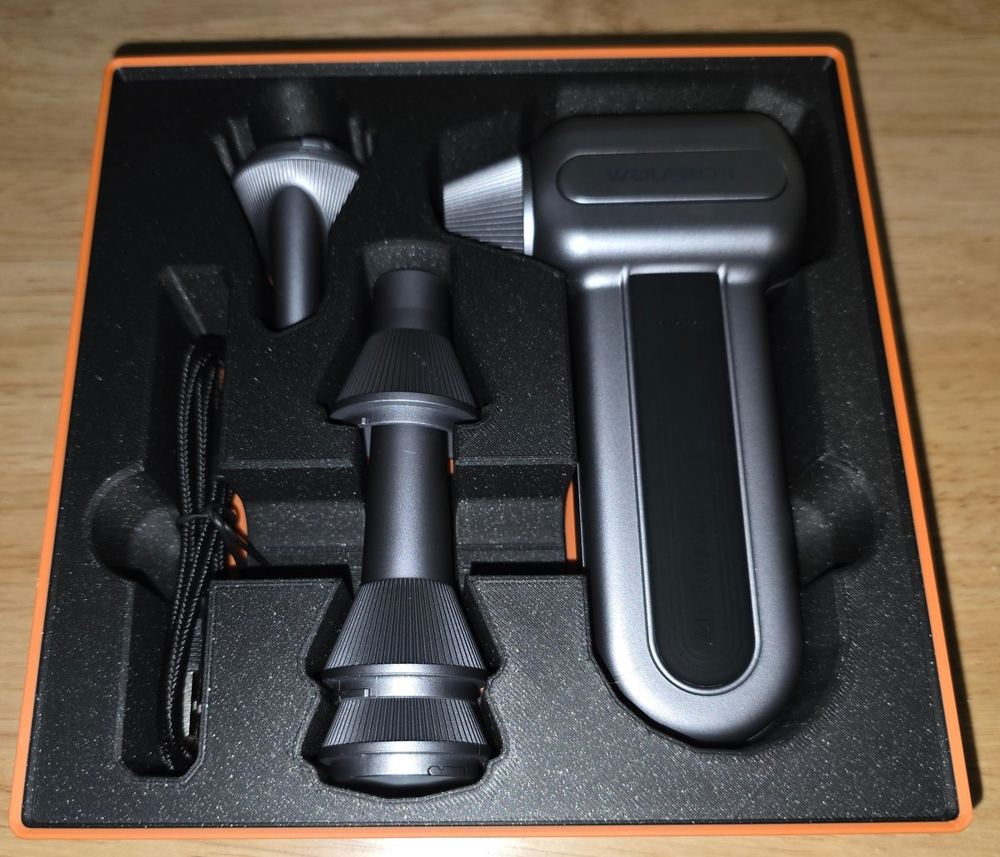
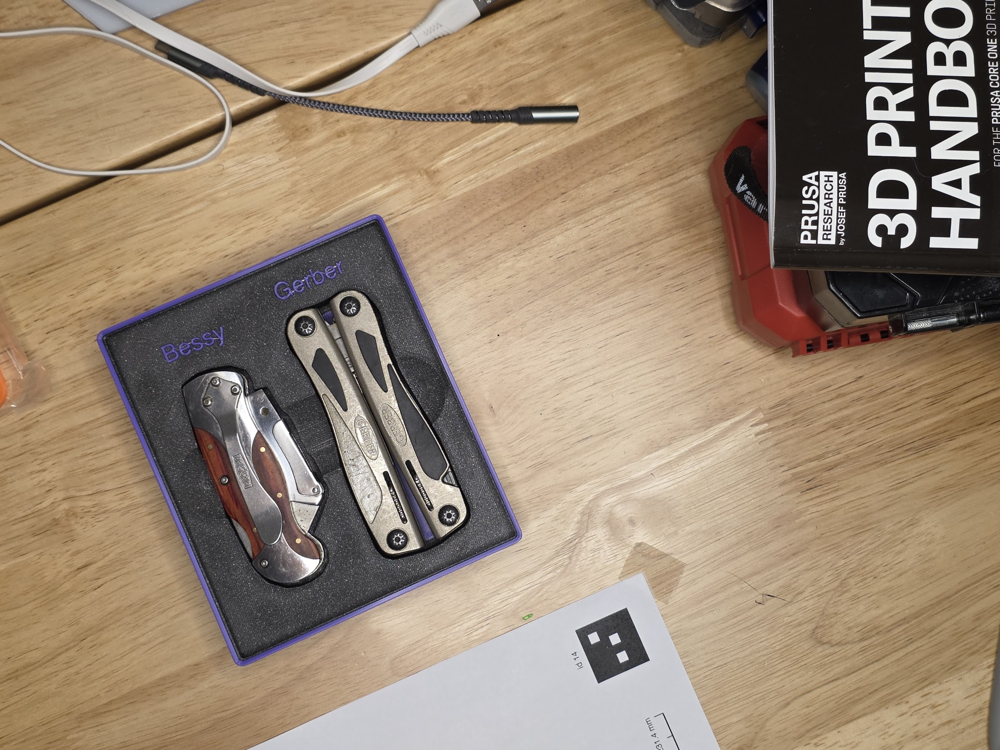
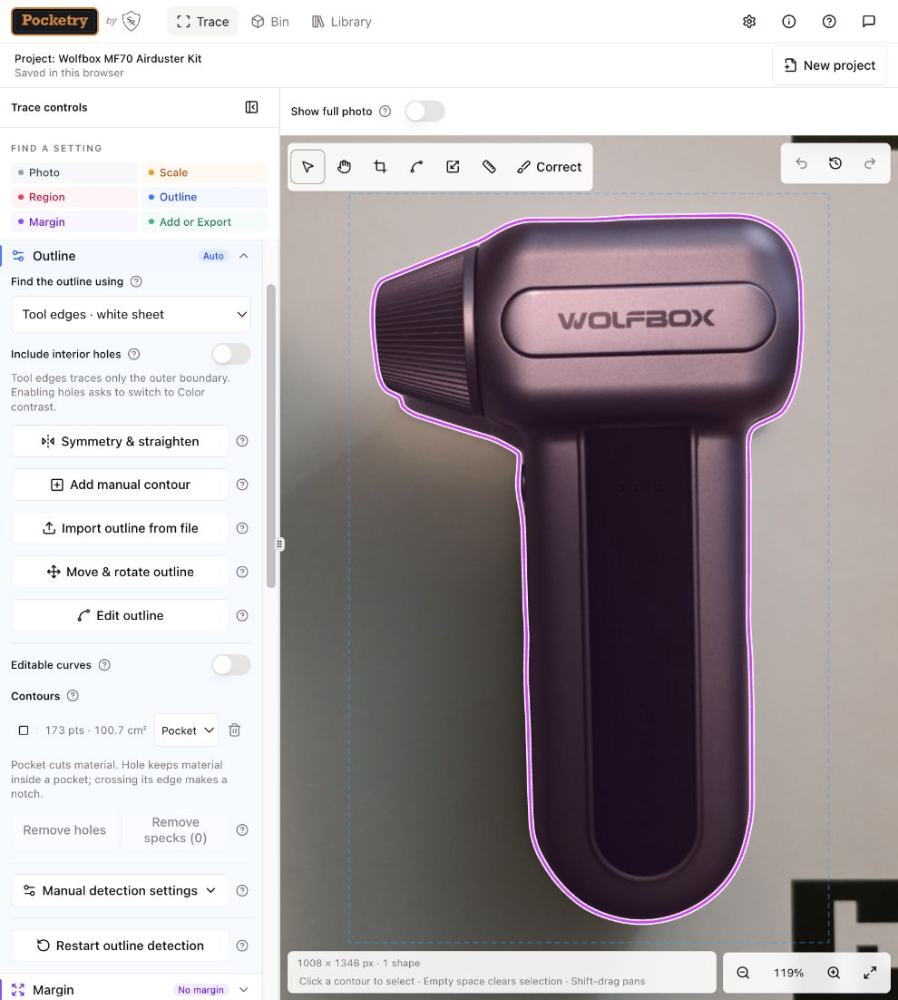
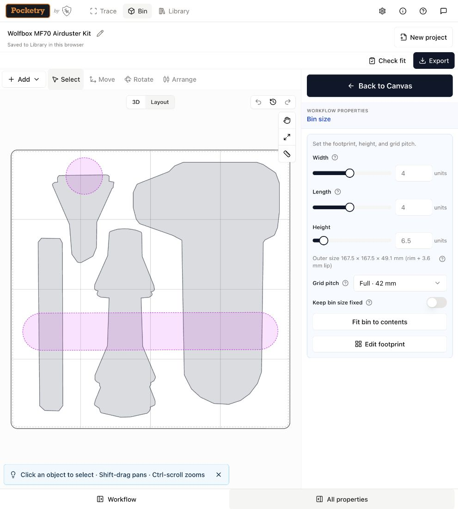
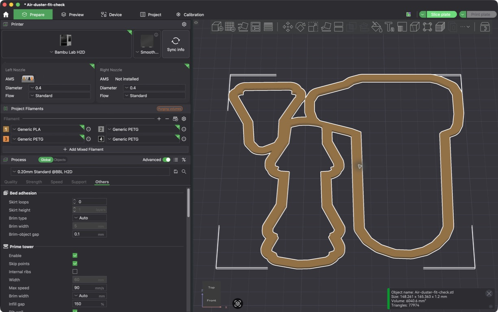
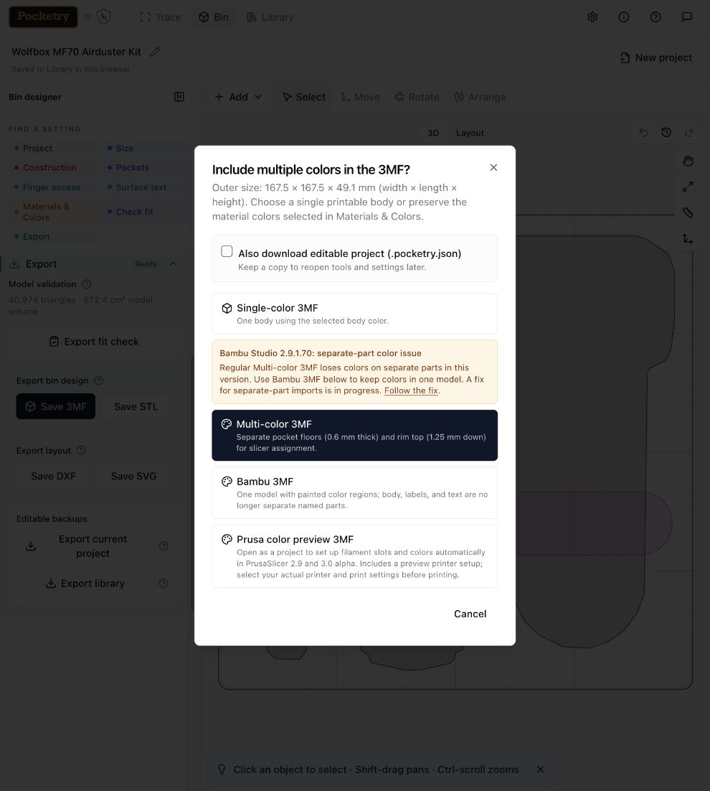
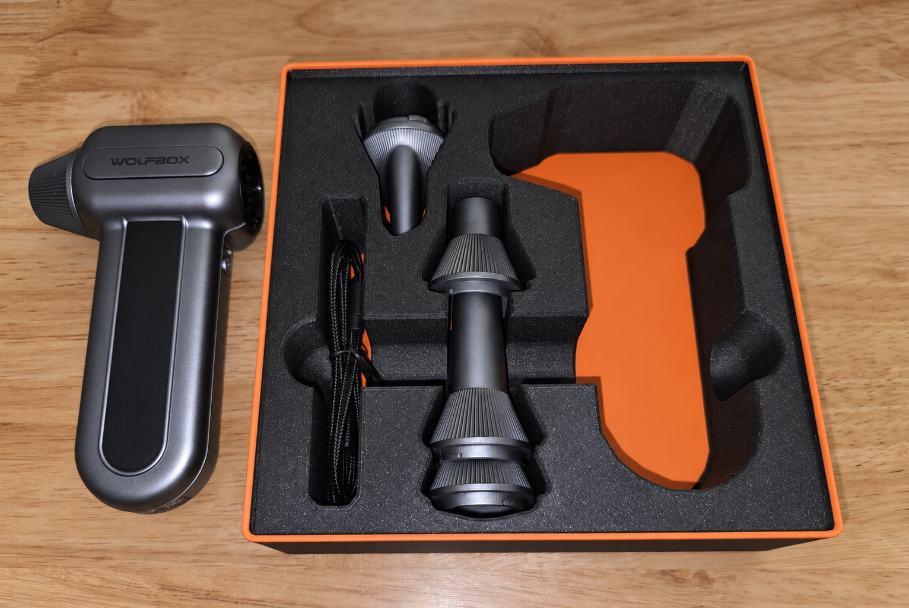

# Pocketry

Pocketry is an open source project that turns photographs of items or tools into
editable outlines, shadow-board files, and printable bins with Gridfinity or
flat bottoms. The application runs in the browser, with image processing,
project storage, and model generation kept on the user's device.

[Try Pocketry](https://pocketry.xyz) ·
[Sample projects](samples/README.md) ·
[Documentation](docs/README.md) ·
[Issues and roadmap](https://github.com/wcscr/pocketry/issues) ·
[View the source](https://github.com/wcscr/pocketry) ·
[Version history](CHANGELOG.md) ·
[Read the license](LICENSE) ·
[Read third-party notices](NOTICE)

Pocketry's public deployment is [https://pocketry.xyz](https://pocketry.xyz).

## What it does

- Trace and refine outlines from PNG, JPEG, or WebP photos, or import closed SVG outlines.
- Calibrate dimensions and correct perspective with printable reference sheets.
- Design Gridfinity or standalone flat-bottomed bins with custom pockets, finger access, and colors.
- Build hollow compartment bins with scoops, label tabs, and raised text or hardware symbols.
- Create 3D-printable positioning fixtures for laser engraving and UV printing; [Wham Bam Systems ULTIM8™](https://www.whambamsystems.com/pages/ultim8-jig)-compatible fixtures start with eufyMake E1 mat pegs and export a 1:1 alignment SVG. [Fixture guide (Beta)](https://pocketry.xyz/help/ultim8).
- Preview in 3D and export fit checks, STL, or 3MF models.
- Export SVG or DXF files for shadow boards and CNC work.
- Save projects locally, undo changes, and export editable backups.

Check dimensions against the real items and print a fit test before the final bin.

## About Gridfinity

Gridfinity is a modular, 3D-printable storage system created by
[Zack Freedman](https://www.youtube.com/c/ZackFreedman). Its bins and holders fit
a shared baseplate grid, so you can rearrange and expand your storage as your
collection grows. Pocketry builds on that system by turning tool photos into
custom Gridfinity bins. It also supports standalone flat-bottomed bins for
use directly in a drawer or on a worktop, with no Gridfinity baseplate needed.

Watch Zack's [original Gridfinity introduction](https://www.youtube.com/watch?v=ra_9zU-mnl8)
and browse [his original designs on Thangs](https://thangs.com/designer/ZackFreedman).

## Sample projects

The sample library includes physically printed designs and photographs, plus
editable variants. Browse the [sample projects](samples/README.md) for editable designs, printable
3MFs, and photos. Each project page includes its downloads, dimensions, and any
fit or stacking notes.

| [Wolfbox MF70 Airduster Kit](samples/wolfbox-mf70-airduster-kit/) | [Bessey and Gerber](samples/bessey-gerber/) |
| :---: | :---: |
| <a href="samples/wolfbox-mf70-airduster-kit/"></a> | <a href="samples/bessey-gerber/"></a> |

**[Browse all examples and download the editable library →](samples/README.md)**

We'd love to see what you make with Pocketry! If you share a design on MakerWorld,
Printables, or elsewhere, please give Pocketry a shout-out and link to
[pocketry.xyz](https://pocketry.xyz).

## Basic Process

### 1. Trace the tools

This example uses the [Wolfbox MF70 Airduster Kit](samples/wolfbox-mf70-airduster-kit/).
To follow the Bin steps without tracing first, choose **Open Sample Projects**
on Welcome, or **Library → Sample Library**, and open that sample.
The editor screenshots show version 1.12.0; print photos show the original bin.
[Image sources and capture steps](docs/images/README.md).

Photograph one tool at a time from directly above on plain, contrasting paper.
Keep the whole tool and all four calibration-sheet markers visible. Print the
optional v3 A4 or US Letter sheet at **100% / Actual size**. For tall tools,
move farther away, then zoom as needed while keeping the markers sharp. A
measurement aid at the relevant tool height can reduce scale error; see
[calibration and photography guidance](docs/calibration/object-reference-strip.md).

Open the original PNG, JPEG, or WebP in **Trace**. In **Scale**, accept
**Correct perspective & use scale** for the sheet, or **Correct perspective &
use aid scale** when a suitable aid is detected. Alternatively use **Set scale**,
mark a known distance, and **Confirm scale**. Measure a real tool dimension to
check the result. Use **Show full photo** if correction crops a wide tool.

Choose **Region → Set region** and draw a box around the tool, leaving some
paper around it. **Tool edges · white sheet** is the default for new traces.
Under **Find the outline using**, choose **Color contrast** for other backgrounds,
or **Automatic · match background** to choose from the background. Detection
cleans up straight lines, rounded sections, and small dips automatically.
Review tips, shadows, and amber edges, where a hidden boundary was estimated.

Use **Correct** beside the canvas, then **Add** to mark missing tool material
or **Remove** to mark unwanted paper or shadow. Each completed stroke re-detects
and can be undone; **Done** hides the marks while keeping their effect. Correct
before editing points, or undo those edits before returning to corrections.
**Manual detection settings**, below the contour list, contains **Sensitivity**
(Auto by default), point **Simplification**, **Smooth outline**, and **Detected
outline**. Smooth outline offers an Original/Preview comparison and one undoable
Apply. Detected outline previews the earlier, lightly smoothed detection; **Use
detected outline** restores it. These controls adjust detected geometry, not fit
clearance. [Detection controls and limits](docs/teed-outline-integration.md).

**Edit outline** lets you drag points, click an edge to add one, or right-click a
point to delete it. Shift-click or box-select points to move a group; **Select
points** also works by tapping. **Repair section** replaces the run between
selected endpoints with a previewed line or curve. Enable **Editable curves**
for curve handles and **Bend edges**. Turning it off converts curves to points
as one undoable edit. [Curve editing and export behavior](docs/contour-curves-prototype.md).

**Include interior holes** uses Color contrast; choosing it from Tool edges asks
to switch methods and re-detect. In **Contours**, **Pocket** cuts material and
**Hole** keeps material inside a pocket. **Add manual contour** starts another
four-point outline, useful for an inner feature needing a different depth.
**Restart outline detection** resets tuning and corrections while retaining the
photo, scale, region, and margin; Undo restores the previous result.

Choose **Add to Bin** when the outline looks right. New pockets start **To bin
floor**; set their depth in Bin. Trace **Margin** is optional; leave it at zero
while refining and use Bin's **Extra pocket clearance** for fit. Objects traced
together retain their relative positions, and holes remain separately editable.



### 2. Arrange the pockets

In **Bin**, set **Bin size** (the Wolfbox example is **4 × 4 cells**, **6.5u** high).
Use **Construction → Base & mounting → Bottom → Flat bottom** for a standalone bin. In **Layout**,
drag pockets into place and add finger access where needed. Select a pocket to
adjust its size, position, and depth.

Use **Add pocket → Import SVG pocket** for a closed vector outline. SVG physical
units set its size; use the optional width override for unitless artwork. Choose
a pocket depth, then place and edit it like any other pocket. Files stay local;
stroke widths are ignored and referenced resources, effects, and open paths are rejected.
Native Inkscape SVGs can keep their editor metadata and paint-order styles.
Flatten clipping, masks, and filters into closed paths before importing.

To adjust an SVG outline against its photo instead, use **Outline → Import outline from file**
in Trace. An SVG exported from the same photo returns to its exact position; any
other file is placed at true size and turned to fit the current outline, which
puts a straightened or rotated outline back over the tool. **Move & rotate outline**
then shifts or turns any contour by hand without changing its size. Replace the
current outline or add to it, then edit its points. The import is one undoable step and
follows the same file rules, with one exception: a contour that crosses or touches
itself is imported as drawn, with a note, so you can repair it over the photo. With
**Editable curves** on, imported contours arrive as straight-edged points that you
can then bend.

SVG parsing uses [fast-xml-parser](https://github.com/NaturalIntelligence/fast-xml-parser)
and [svgpath](https://github.com/fontello/svgpath), both MIT licensed.



### 3. Check tool shapes and sizes

Compare the pockets with measurements of the real tools using
**Measure between contours** and **Size & scale**. Check depth and remaining
floor in **3D** or **Check fit → Inspect inside**.


### 4. Print a fit check

In **Check fit**, save a **Full surface** or **Tool outlines** fit test STL.
Print it at **100% scale** (we recommend **0.6–0.8 mm** thick) and try the real
tools. Adjust the outline or clearance if needed. This checks the openings,
not pocket depth or baseplate fit.

The original slicer screenshot below shows an earlier **1.2 mm** fit check.



### 5. Export and print the finished bin

Set every pocket's depth, then use **Export → Save 3MF** or **Save STL**.
Open the file in your slicer at **100% scale** and review the layer preview
before printing. **Multi-color 3MF** exports selected colors as separate parts.
For Bambu Studio 2.9.1.70, choose **Bambu 3MF** to keep painted colors in one
model. **Prusa color preview 3MF** sets up filament slots and colors when opened
as a project in the tested PrusaSlicer versions. It loads a preview printer
configuration: select your actual printer, materials, and print settings before
printing. Both compatibility options combine the named parts into one model
([version-specific details](docs/bambu-3mf-compatibility.md)). SVG and DXF layouts are available
for shadow boards and CNC work.






### Save an editable copy

Use **Project → Save this draft to Library** to name your design, then
**Export project** for an editable `.pocketry.json` backup. Projects live in
this browser and do not sync between devices. The backup does not include the
original Trace photo, so keep that separately.

## Privacy

The static application processes images and generates models locally in the
browser. Projects are stored in the browser using IndexedDB. The hosted version
does not require uploading tool photographs to Pocketry's server. The local Node
server serves the editor and static assets only; the retired `/api/images` endpoints
return 404 and do not accept or store uploads.

## Run locally

There are two ways to run Pocketry locally: with **Node.js 26 and npm**, or with
**Docker**.

Start by cloning the repository:

```sh
git clone https://github.com/wcscr/pocketry.git
cd pocketry
```

### Option 1: Node.js and npm

Install Node.js 26 and npm (`npm ci` stops with an engine error on other
versions), then build and start Pocketry:

```sh
node --version # Must report v26.x
npm ci
npm run build
npm start
```

Open <http://localhost:5000>. This production server listens on all host
interfaces; see the self-hosting guide below for network access and HTTPS.
On macOS/Linux, use `PORT=5001 npm start` if the default port is in use.
On Windows PowerShell, use `$env:NODE_ENV="production"; node dist/index.js`
instead of `npm start`. See the [self-hosting guide](docs/self-hosting.md#without-docker)
for port overrides and upgrades.

For development with live updates, use this instead of `npm start`:

```sh
npm run dev
```

The Vite development server binds only to IPv4 loopback at
<http://127.0.0.1:5000>, so other computers cannot access it. It rejects untrusted
Host names, restricts file access to application sources, dependencies, and
public/legal assets, and disables its desktop-editor launch endpoint. Pocketry's
Trace and Bin editors remain available. Use `PORT=5001 npm run dev` on macOS/Linux
to choose another port. Use the production build or Docker for ongoing hosting.

### Option 2: Docker

Install Docker Engine or Docker Desktop with Docker Compose. No separate Node.js
or npm installation is needed.

```sh
docker compose up -d --build
```

Open <http://localhost:8080>. The container serves the production build and is
accessible only on this computer by default. Stop it with `docker compose down`.

### Hosting and backups

Follow the [self-hosting guide](docs/self-hosting.md) for access from other devices,
HTTPS, static hosting, upgrades, and backup/restore instructions. Projects remain
in each user's browser. Use **Export project** and **Export library** for
backups—copying the server or container does not back up your designs.

### Command-line bin export

With Node 26 and dependencies installed, `npm run export:bin` writes an empty
2 × 3 × 6u bin as STL and 3MF under `exports/`. For example:

```sh
npm run export:bin -- 4x2x3 --fill solid --no-lip --out /tmp/pocketry-exports
```

This helper accepts bin dimensions, fill, lip, and output directory; it does not
load a saved project. Use the browser's Export controls for designed pockets and
colors.

## Verify and build

Run the required type-check and test gate:

```sh
npm run check
npm test
```

`npm test` runs the quick suite. Changes to detailed geometry, exports, or UI
workflows also need the relevant qualification/workflow suites listed in
[CLAUDE.md](CLAUDE.md). Verification runs locally; hosted CI is disabled.

Create the production build in `dist/public`:

```sh
npm run build
```

The build includes `LICENSE.txt` and `NOTICE.txt` alongside the application.
`NOTICE.txt` includes full license texts for bundled npm dependencies, including
transitive packages used by browser and worker code. See the
[notice maintenance guide](licenses/npm/README.md) when updating dependencies.

## Versions and update history

About displays the version from `package.json`; [CHANGELOG.md](CHANGELOG.md)
tracks notable updates. Contributors add short **Unreleased** entries for
user-visible changes; maintainers edit and combine them. Documentation-only
changes, tests, and internal refactors usually need no entry.

For releases, maintainers use `npm version patch --no-git-tag-version` (or `minor` for new
features, `major` for breaking changes), then date the matching changelog entry.
Commit both package files and the changelog together after verification.

## License and attribution

Pocketry's original work is licensed under the
[GNU Affero General Public License v3.0 only](LICENSE). Commercial use is
permitted, but modified distributed versions and modified versions offered over
a network must comply with the AGPL's source-sharing requirements.

Third-party components and adapted source retain their original licenses. Their
licenses, copyright notices, and provenance are recorded in [NOTICE](NOTICE).
The detailed direct-source review is available in
[docs/open-source-review.md](docs/open-source-review.md).

Surface labels include 18 hardware symbols adapted from
[GFLabel](https://github.com/ndevenish/gflabel) by Nicholas Devenish under
[BSD-3-Clause](client/public/licenses/gflabel.txt). Choose **Add → Surface text**,
then **Symbol** to pair one with wording or use it alone. See
[symbol provenance and regeneration](docs/hardware-symbols.md).

## Contributors

Pocketry is developed and maintained by Sugarcreek Research, LLC.

[Arucious](https://github.com/Arucious) contributed SVG pocket import.

[OpenAI Codex](https://openai.com/codex/) and
[Anthropic Claude](https://claude.com/claude-code) are AI contributors to the project,
assisting with implementation, testing, documentation, and code review. This
acknowledgment includes work not individually credited in the commit history.

## Contributing

Issues and focused pull requests are welcome. [CONTRIBUTING.md](CONTRIBUTING.md)
covers local checks, dependency/provenance disclosure, and one-time CLA acceptance.
You keep copyright and submit under AGPL-3.0; the [CLA](CLA.md) also
allows Sugarcreek Research, LLC to offer other licenses, including proprietary
versions without royalties or automatic publication.

### Browser and import limits

Use Safari 16.4+, Chrome/Edge 111+, or Firefox 128+ for the current styling engine.
Project imports are limited to 64 MiB and library backups to 128 MiB / 500 designs.
Resource checks also limit ring length, total geometry, and repeated placements
across undo history and transform sources. Over-limit imports are rejected in full;
existing work is kept. Split large library backups or simplify unusually detailed
designs before importing. See [import limits](docs/import-limits.md) for exact bounds.
