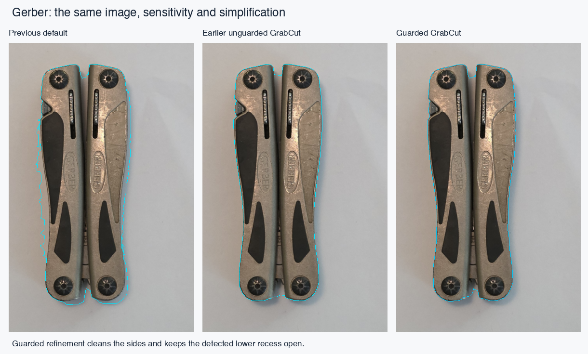
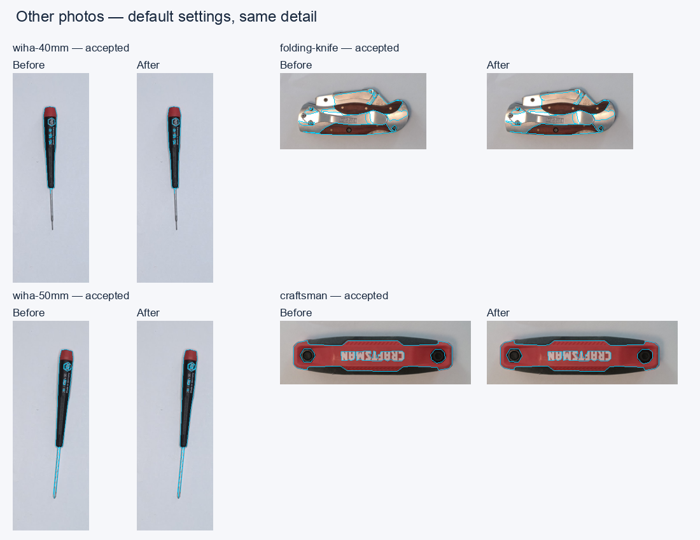

# Photo boundary refinement — local evaluation, 2026-11-05

This change enables real, mask-seeded **CPU/WASM GrabCut** in the existing detector. It improves the Gerber sides while retaining the detected lower recess. TEED was successfully exported and run through the shipped OpenCV DNN, but the measured boundary proposals did not improve on guarded GrabCut, so **no neural model, runtime, download, or enhancement switch ships**.

The [expanded example-library report](photo-refinement-evaluation/library/README.md) adds **57 before/after detections**, including all 27 published photos, with seven paired warm timing runs per method and a visual assessment of each case. Its [standalone HTML](photo-refinement-evaluation/library/report.html) has searchable side-by-side panels.

This records local implementation and validation for review, not deployment or phone qualification. The change was developed from `361c582b` and rebased onto the 1.6.1 target (`a13f91e8`) for the PR. Intervening changes affected release metadata and an unrelated Bambu export warning, not this detection code. Download comparisons retain the original base for reproducibility.

## Implemented behavior

Inspection of the base source found `refine: "none" | "grabcut"` and comments describing GrabCut, but no actual invocation in detection. The new stage calls the shipped `cv.grabCut` twice, with one iteration each: `GC_INIT_WITH_MASK`, then `GC_EVAL`. A fixed RNG seed makes repeated results comparable.

The independently designed acceptance workflow is:

1. Preserve the existing score field and the original color evidence before morphology. Crop to the user's region at the existing detector resolution.
2. Label strong interior foreground and strong background as definite seeds. Keep uncertain pixels probable foreground/background. Protect foreground touching the region boundary rather than inventing a background frame. Protect connected, evidence-supported thin runs through six pixels, which cannot otherwise contain the seven-pixel interior seed window.
3. Run two bounded CPU GrabCut iterations in a module worker, using the existing worker RPC architecture. A worker keeps the UI responsive; it does not accelerate the CPU solver.
4. Intersect the proposal with the existing foreground. Existing background vetoes additions, so a previously detected recess or hole cannot be filled. This deliberately conservative version cannot recover geometry missing from the initial mask.
5. Reject substantial per-object area loss, splitting, disappearance, changed significant hole counts, or changes to the final normalized polygon topology. Retain the exact original score/outline on rejection or solver failure. Unchanged boundaries keep their original subpixel scores; newly cut boundaries use symmetric pixel crossings. No new smoothing or symmetry rule is applied.

Alpha silhouettes remain authoritative and skip color refinement. Selections containing inferred occlusions also skip it. Fields above 750,000 pixels keep the baseline; this is a solver eligibility limit, **not a change to the working image cap or resolution**. The ordinary 800×600 image fits; large perspective-corrected images retain their existing resolution.

The detection worker owns its OpenCV instance. Cancellation/superseding terminates synchronous WASM work; cooperative task yields also check aborts between stages/iterations. Queued jobs are serialized, stale replies are ignored, a stalled request times out after 30 seconds, and an idle worker is released after 30 seconds. `MatScope` disposes crop, RGB, mask and GMM handles in `finally`. Missing OpenCV keeps the existing JS baseline. A crashed worker rejects the request, leaves the editor's previous outline intact, and can be recreated on retry.

The only OpenCV bundle modification is its UMD global root (`this` → a `globalThis` fallback) so it can initialize inside a strict module worker. The embedded WASM and algorithms are unchanged. The build script applies this packaging patch reproducibly; existing Apache notices remain delivered.

Image coordinates, ROI offsets, calibration, saved-project schemas, simplification settings and the single px→mm/export boundary are unchanged. The existing main-thread calibration preflight is also unchanged; responsiveness measurements below cover detection, not every operation during photo loading/calibration.

## Boundary evidence



The Gerber fixture is the specified photograph `20260927_164649.jpg`, Pillow bilinear sampled to 384×600, full-frame region, default sensitivity and unchanged simplification. The middle panel is the earlier experimental three-iteration result, not the production implementation. The new mask retains both detected end recesses, removes side shadows, and does not trace the dark handle inserts as holes. The test asserts original-image landmarks rather than rewarding fewer vertices.

Ten manually read silhouette crossings at five original-image rows give:

| Method | Mean absolute distance to annotated crossings |
| --- | ---: |
| Previous default | 6.25 px |
| Guarded GrabCut | 0.45 px |
| GrabCut + local TEED 512 proposal | 1.15 px |
| GrabCut + local TEED 256 proposal | 1.05 px |

These are **sparse, single-evaluator annotations with approximately ±1.5 px uncertainty**, not full ground-truth masks or dimensional accuracy claims. The large side-shadow improvement is visible; the small TEED differences are insufficient evidence of a benefit. Exact rows, references and measurements are in [boundary-quality.json](photo-refinement-evaluation/boundary-quality.json). The lower recess is separately covered by foreground/background regression landmarks.



Five real photographs were compared, plus synthetic tests:

| Photograph | Evidence and limitation |
| --- | --- |
| Gerber, 384×600 | Cleaner sides, retained upper/lower recesses, dark inserts retained as material. |
| Wiha 50 mm, 161×443 | Reflective thin shaft remains at default sensitivity; nearby background remains excluded. |
| Wiha 40 mm, 161×443 | Default still misses much of the low-contrast shaft, as the baseline does. At the established regression sensitivity 100, refinement preserves the shaft. This is **not** a claim that manual tuning is eliminated on all photos. |
| Folding knife, 230×120 crop | Final thin-feature guard preserves the bright narrow sections and permits a small subtraction. Existing internal false holes remain; refinement does not reinterpret manufactured details. An earlier four-pixel guard rejected this case for area loss, motivating coverage of the five/six-pixel seed gap. |
| Craftsman folding tool, 330×110 crop | Small outer-shadow cleanup; existing interior segmentation remains. Lettering is not used to move the outer boundary. |

The knife and Craftsman crops come from maintainer photos `20260927_164630.jpg` and `20260927_164640.jpg`, respectively, bilinear sampled to 800×600 then cropped at `(335,260,230,120)` and `(270,250,330,110)`. Only the supplied Gerber was added as a regression fixture; the two Wiha fixtures already existed. The local comparison figures include the additional maintainer photos; no photograph was uploaded.

Synthetic cases cover a narrow concave notch, shafts, an actual hole, multiple objects, a low-contrast object and cast shadow, ROI-clipped foreground and transparent RGBA. Guard tests cover object disappearance, split bodies, invented holes, unsupported growth, solver failure, cancellation and cleanup. Existing trace tests cover optional hole filtering and coordinate/export contracts. This is a useful regression set, not a representative accuracy benchmark across all tools/backgrounds.

## CPU, memory, download and responsiveness costs

The reproducible Node benchmark uses the **actual shipped OpenCV 4.11 artifact**, Node 22.22.2, macOS arm64. [benchmark.json](photo-refinement-evaluation/benchmark.json) records initialization, per-stage time, three warm total-detection runs, input hashes and memory samples. Node results are not browser or phone timings. Final runtime initialization was 121 ms. See the adjacent JSON for exact measurements.

| Photo | Three warm total-detection runs |
| --- | ---: |
| gerber | 187, 179, 178 ms |
| wiha-40mm | 53, 58, 52 ms |
| wiha-50mm | 57, 56, 56 ms |
| folding-knife | 34, 35, 36 ms |
| craftsman | 35, 35, 37 ms |


Desktop browser checks used the 384×600 Gerber with a `requestAnimationFrame` heartbeat alongside the real worker:

| Environment | Cold detection / CV initialization | Warm total detection | Largest sampled frame gap |
| --- | ---: | ---: | ---: |
| Chrome 156, installed desktop browser in headless mode, earlier candidate | 344 / 69 ms | 137–159 ms | 16.8 ms |
| Edge 156, installed desktop browser in headless mode | 388 / 102 ms | 155–167 ms | 16.8 ms |
| Safari 26.6.2, native macOS UI, source worker | 525 / 161 ms | 138–179 ms | 29 ms |
| Safari 26.6.2, native macOS UI, compiled production worker | 389 / 77 ms | 143–182 ms | Not recorded |

These are short, local, uncontrolled samples, not percentile/long-task benchmarks or network cold-start tests. Chrome was checked before the final polygon topology pass; Edge and Safari included that pass. The final six-pixel seed guard was subsequently verified in the actual-WASM regression suite and Node benchmark, not rerun in every browser. A further native Chrome check could not attach through the available UI control. Browser evidence and scope are in [browser-validation.json](photo-refinement-evaluation/browser-validation.json). Safari also exercised abort and successful retry through the source worker client. The compiled-worker check used the real worker RPC and OpenCV import, not a mocked solver.

No Windows PC, physical iPhone, iPad or Android device was available. No mobile emulation result is presented as real-device evidence. Core code uses standard module Workers and CPU WASM with a JS baseline, with no GPU requirement; cross-platform behavior and especially phone memory pressure remain unqualified.

The detector's WASM heap capacity stayed at **128 MiB** in the five-photo benchmark. That is capacity, not peak physical memory. The app's existing calibration OpenCV instance can coexist with the detector, potentially reserving **256 MiB across two WASM heaps**, plus image/JS/graph memory. The idle-worker timeout releases the detector after a burst. For the complete Node benchmark process (runtime, five photos, baseline/refined and warm repeats), macOS reported 343,048,192 bytes maximum RSS (327.2 MiB) and 312,345,736 bytes peak memory footprint (297.9 MiB), not detector-only incremental usage. See [memory-measurement.json](photo-refinement-evaluation/memory-measurement.json). OS process peak and sampled memory are recorded with their scope; no reliable browser-wide or real-phone peak memory measurement was available. Catchable solver allocation errors fall back; a browser killing the worker/tab under pressure cannot be guaranteed recoverable.

Download accounting compares complete production JS assets against the base build, summing gzip-compressed files separately. The new worker is approximately 28.5 KB raw / 11.4 KB gzip; the total JS increase, including main-thread loader/client code, is approximately **34.6 KB raw / 13.8 KB gzip**. The existing self-hosted OpenCV bundle remains approximately 11.37 MB raw / 3.86 MB gzip; its wrapper patch adds 49 raw bytes (6 gzip bytes). No duplicate runtime file, model, inference runtime, or GPU loader is shipped. The test fixture and evaluation figures are not application assets. Exact final sizes are in [download-costs.json](photo-refinement-evaluation/download-costs.json); these are compressed artifact sizes, not an HTTP transfer capture.

## TEED experiment and integration decision

The official [TEED repository](https://github.com/xavysp/TEED/tree/40fa4b1391dc6424f88989d0ca75d5b592c8681d) was evaluated at that pinned revision. Its default BIPED checkpoint `checkpoints/BIPED/5/5_model.pth` contains 58,910 parameters and is 249,139 bytes; SHA-256 `0322caf70f588355aaaf59c2bf5872b21a4b7e9f679971a7a3bb1f69b56a01ba`.

Inspection of the [third-party dynamic FP16 export](https://github.com/eyaler/LordTubeMaster/tree/main/models/teed) found dynamic height/width, NHWC input and three `Shape` nodes. Its prior unsupported dynamic-Shape failure did not establish that TEED was incompatible. Exporting the official model with fixed FP32 NCHW input `[1,3,512,512]`, ONNX opset 13 and the legacy TorchScript exporter removes those dynamic operations. The shipped OpenCV DNN successfully imports and executes it. The ONNX file is 248,782 bytes (about 223.5 KB gzip), SHA-256 `f1a4f305356f9752e1a9af0f43f067ecb93ab4f27c8a5ed7beb9b37970797837`.

Preprocessing converts canvas RGB to **BGR byte values**, subtracts BIPED means `[103.939,116.779,123.68]`, and does **not** divide by 255. Aspect-preserving bilinear resize and replicated letterbox padding produce the fixed input. For Gerber the inner image is 328×512 with 92 pixels of left padding. Output is sigmoid of the fused last logit; crop padding before bilinear resizing to original pixel centers. OpenCV `blobFromImage` uses `swapRB=false`, scale 1 and no crop.

Against PyTorch, all fused probabilities were finite, mean absolute error was approximately `3.24e-8`, maximum `1.73e-6`. A synthetic eight-pixel translation gave zero interior mismatch at the network stride; non-square crops used the explicit inverse letterbox transform. These checks verify implementation agreement/alignment, not subpixel truth of the learned edges. Exact graph operators and numerical/cost results are in [teed-export.json](photo-refinement-evaluation/teed-export.json) and [teed-inference.json](photo-refinement-evaluation/teed-inference.json).

Boundary evaluation uses only a ±3-source-pixel search around accepted mask crossings, averaged over three rows. It does not trace free-standing TEED contours or follow distant lettering/shadows. Even this constrained proposal can select nearby internal metal edges. Both 512 and 256 evidence maps were inspected across all five photos; they did not demonstrate a worthwhile improvement. At 256, two of 90 sampled Wiha 50 mm shaft rows had crossing/collapse proposals; the already-missing Wiha 40 mm shaft was not recovered. These are experiments, not shipped snapping logic.

A preliminary Node 26 CPU/WASM run measured 87 ms runtime initialization, 12 ms model import, 866 ms first inference and 753–871 ms warm inference at 512. WASM capacity grew from 128 MiB to **184.375 MiB**, despite the small checkpoint. The final Node 22 reproducibility run measured 98 ms initialization, 14 ms import, 1,110 ms first inference and 968–995 ms warm inference; it is recorded separately in the JSON. Runtime/version and system load affect these small samples. PyTorch's native timings in [neural-evaluation.json](photo-refinement-evaluation/neural-evaluation.json) must not be substituted for browser WASM latency.

**Decision: do not integrate TEED.** The small, uncertain quality difference does not justify added latency and memory. There is no optional enhancement download before or after user interaction because no enhancement is shipped. No WebGPU runtime or GrabCut solver port was attempted. GPU inference/download/cache engineering was not justified once the boundary-quality gate failed. A future successful neural proposal would still need a total runtime+loader+model budget, versioned self-hosted opt-in caching, cancellation/failure recovery and real-device measurements; this work makes no GPU performance claim.

## Provenance and dependency review

- Application dependencies: **none added or changed by this feature**; manifest/lockfile version metadata advances to 1.7.0. Existing OpenCV 4.11 is Apache-2.0; only its packaging wrapper changed, with a modification notice added to `NOTICE`. The build's delivered `NOTICE.txt` retains existing dependency notices. No new transitive app dependency is introduced; existing advisories were not re-audited and no repository-wide dependency/security audit is claimed.
- Original seeding, subtraction/topology guards, worker integration, tests and evaluation scripts were independently implemented for Pocketry with AI assistance. No GLT implementation or third-party graph-cut port was incorporated. The supplied diagnostic was treated as experimental evidence and a regression comparator, not copied into production.
- TEED upstream source carries MIT, copyright 2022 Xavier Soria Poma. No separate checkpoint license/model card was found. The converter copies the upstream MIT text beside its locally generated ONNX. The checkpoint and converted graph inherit upstream provenance; the absence of a separate weights statement is recorded rather than asserting additional rights. Neither weights, graph nor upstream Python code is included in Pocketry's application or this patch. No third-party dynamic-export artifact/code is redistributed.
- Evaluation-only tools were isolated outside the app: PyTorch 2.9.1 (BSD-style with bundled third-party notices), ONNX 1.20.0 (Apache-2.0), NumPy (BSD), OpenCV Python (Apache/OpenCV notices), Pillow (HPND). Their binaries and dependencies are not redistributed. The generated evaluation code imports the separately obtained pinned upstream; shipping a future model would require review of the actual weight/training provenance and delivered notices for that distribution.
- Gerber was supplied by the maintainer; additional comparison photos came from the same local Downloads set for this evaluation. Their authorship/license was not independently verified; the maintainer subsequently requested inclusion of the evaluation and comparisons in a PR. Existing Wiha fixture provenance remains documented in `client/src/lib/detect/fixtures/README.md`. No third-party stock/training photographs were added. No license terms were accepted on the maintainer's behalf.

## Reproduction and local verification

Use repository Node 22 dependencies installed by `npm ci`. The normal local gate is `npm run check`, `npm test`, `npm run build`, `git diff --check`. Hosted CI remains disabled; no merge or deployment was run. The maintainer requested a review PR after the initial local evaluation. **Passed:** TypeScript check; the final full quick suite after rebasing onto the 1.6.1 target (214 files, 3,416 tests, including 27 new regression tests); production build; focused detection/trace follow-up after allocation-cleanup hardening (126 tests in five files); whitespace checks. The earlier sandbox-only server-port failures were resolved by running the suite with local loopback permission. Detailed CAD geometry qualification was not rerun because construction/kernel/export implementations are unchanged; existing quick geometry, persistence and trace component tests run in the normal suite.

```sh
node --import tsx scripts/evaluate-photo-refinement.ts /tmp/photo-results
# Optional additional local RGBA fixtures:
node --import tsx scripts/evaluate-photo-refinement.ts /tmp/photo-results /path/to/extra-images.json
```

Extra-image manifest entries are `{ "name": "tool", "path": "/absolute/tool.rgba", "width": 230, "height": 120 }`, optionally `gzip` and detection `options`. The script rejects mismatched byte lengths, saves masks/outlines, and reports input hashes.

For neural reproduction, obtain official TEED at the pinned revision into a separate directory and use a separate Python environment with PyTorch 2.9.1, ONNX 1.20.0, NumPy and OpenCV Python. The scripts perform no download:

```sh
python scripts/photo-evaluation/export-teed.py --upstream /path/to/TEED \
  --image /path/to/gerber-384x600.png --output /tmp/teed-evaluation \
  --photo-results /tmp/photo-results
node scripts/photo-evaluation/infer-teed.cjs /tmp/teed-evaluation
python scripts/photo-evaluation/compare-boundaries.py /tmp/photo-results
```

The exporter checks the source revision/checkpoint hash and emits the graph, original-channel input bytes, PyTorch reference and MIT notice. The inference script exercises Pocketry's shipped bundle, checks output shape/finite values and maximum agreement error, frees DNN/Mat handles, and reports runtime/heap costs. `compare-boundaries.py` uses the disclosed sparse Gerber annotations and mask-constrained proposals. No model integration tests are needed in the application because there is no model integration; the repeatable export/import/numerical check is the experiment's validation.
