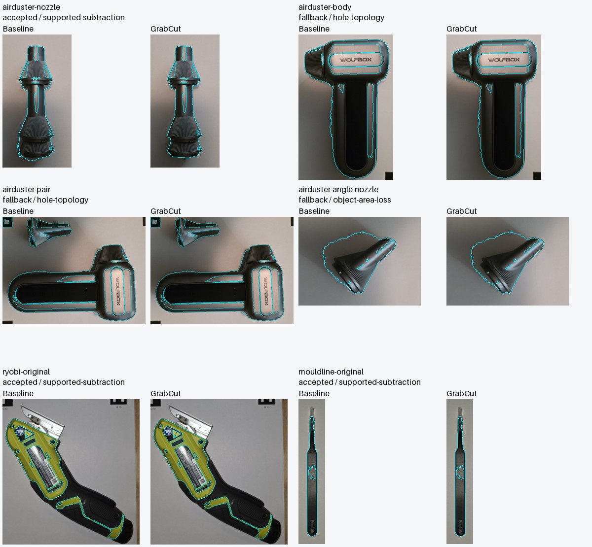
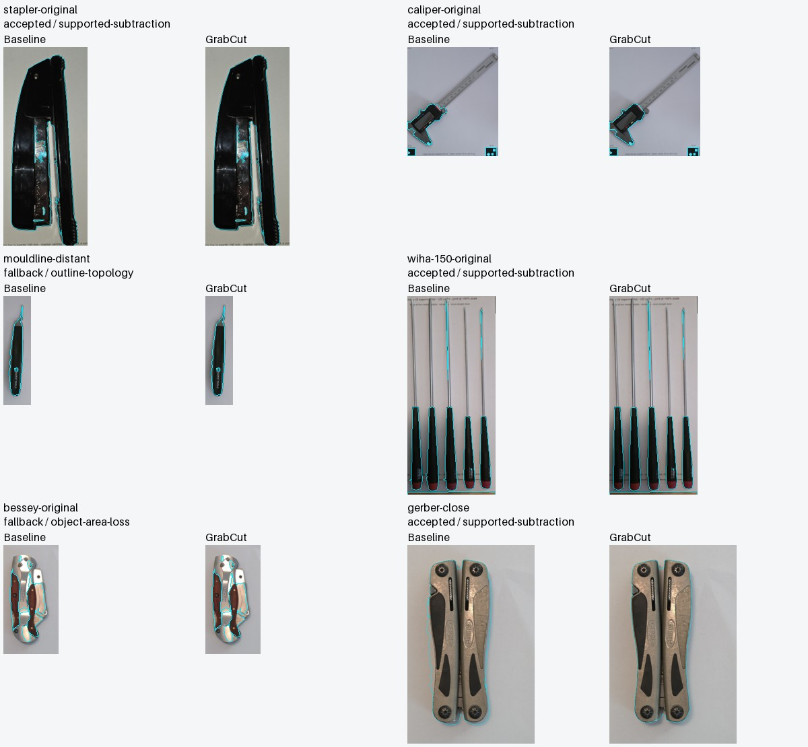
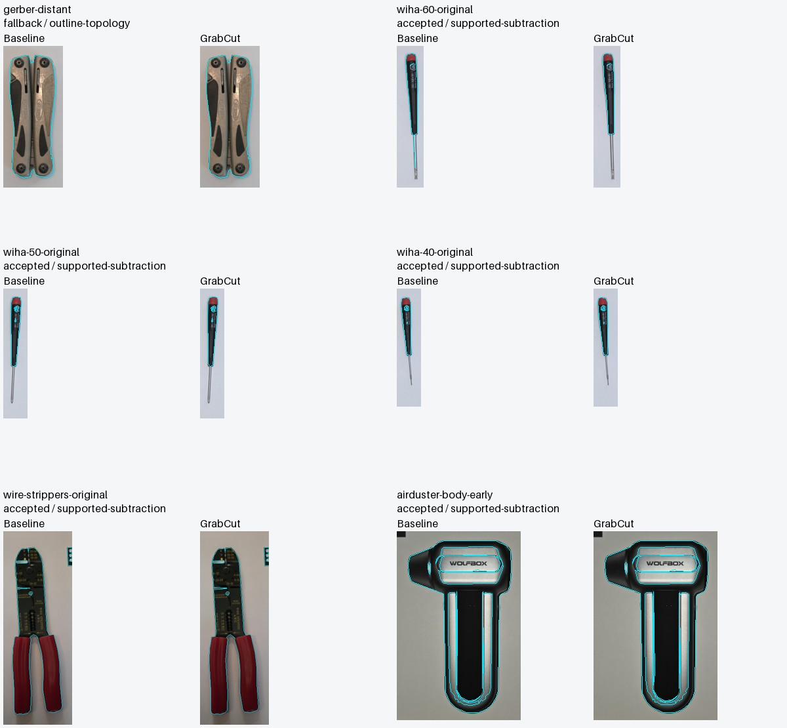
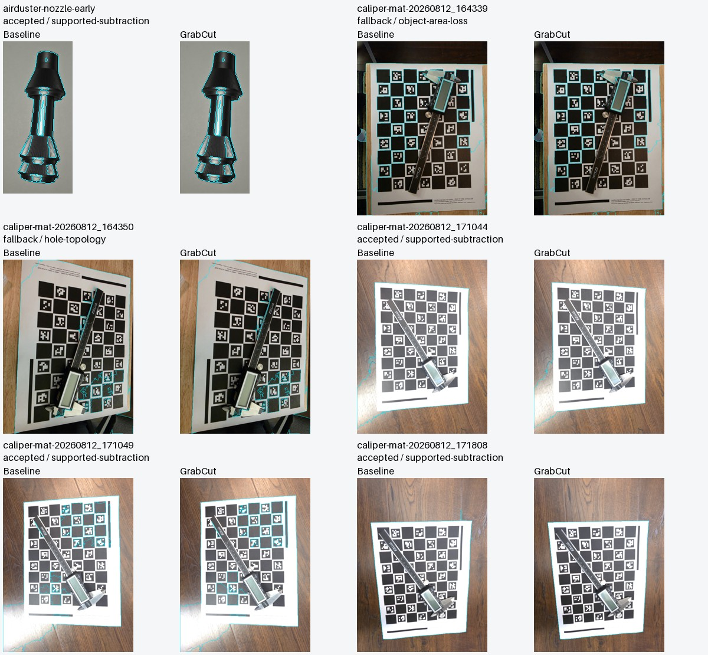
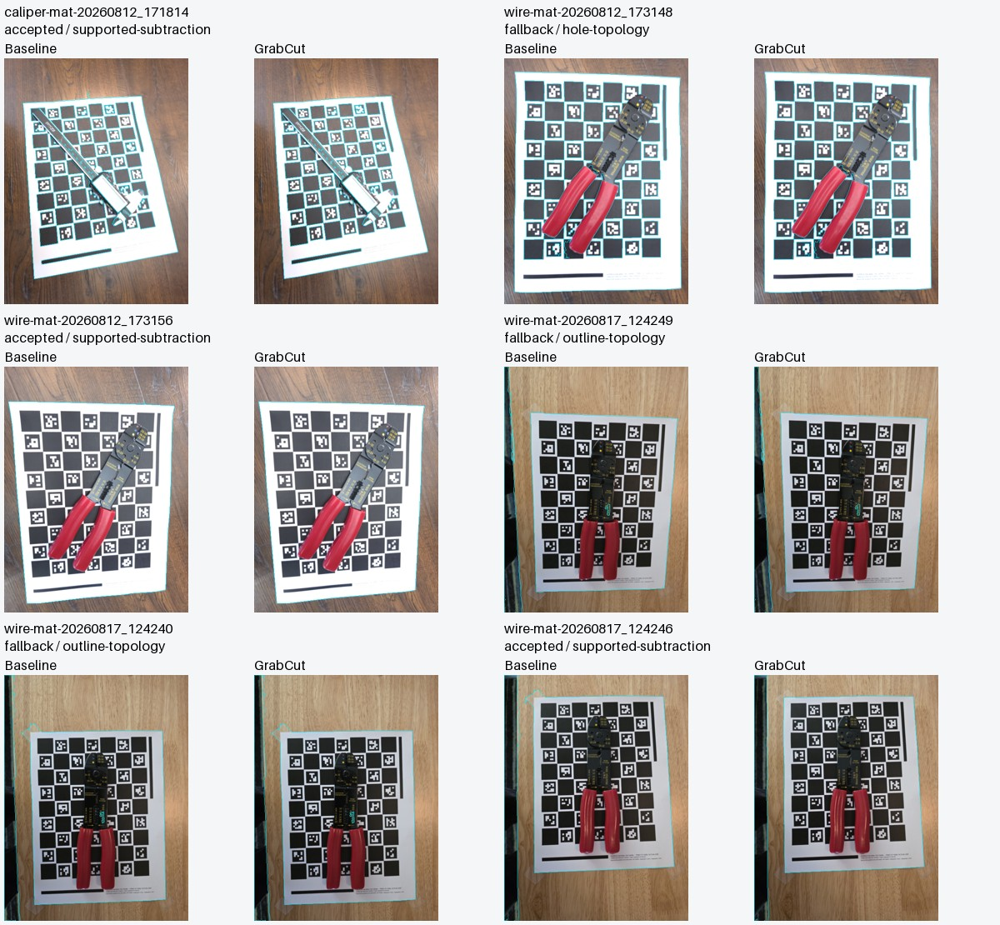
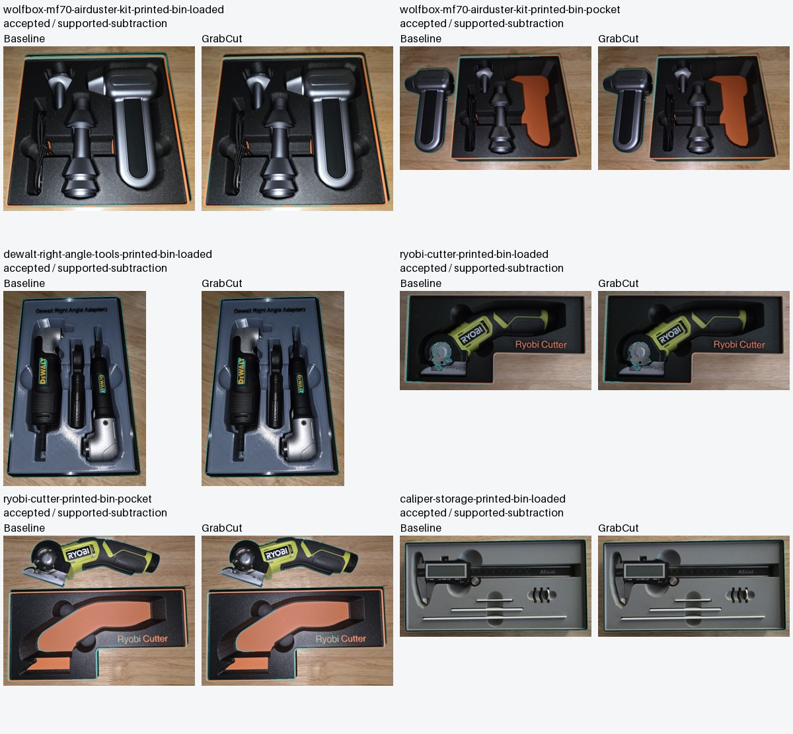
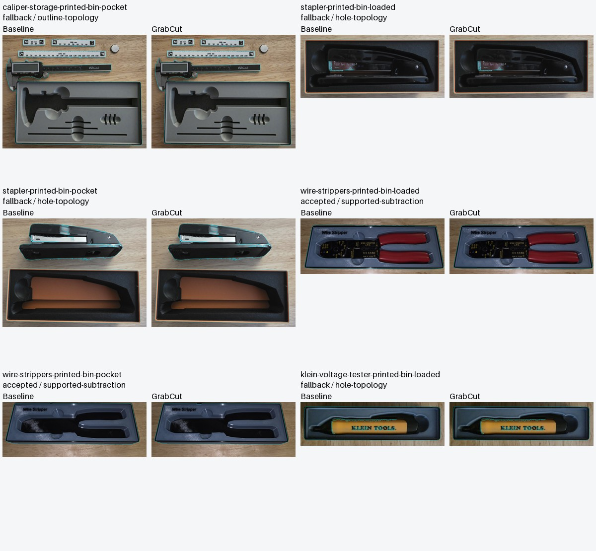
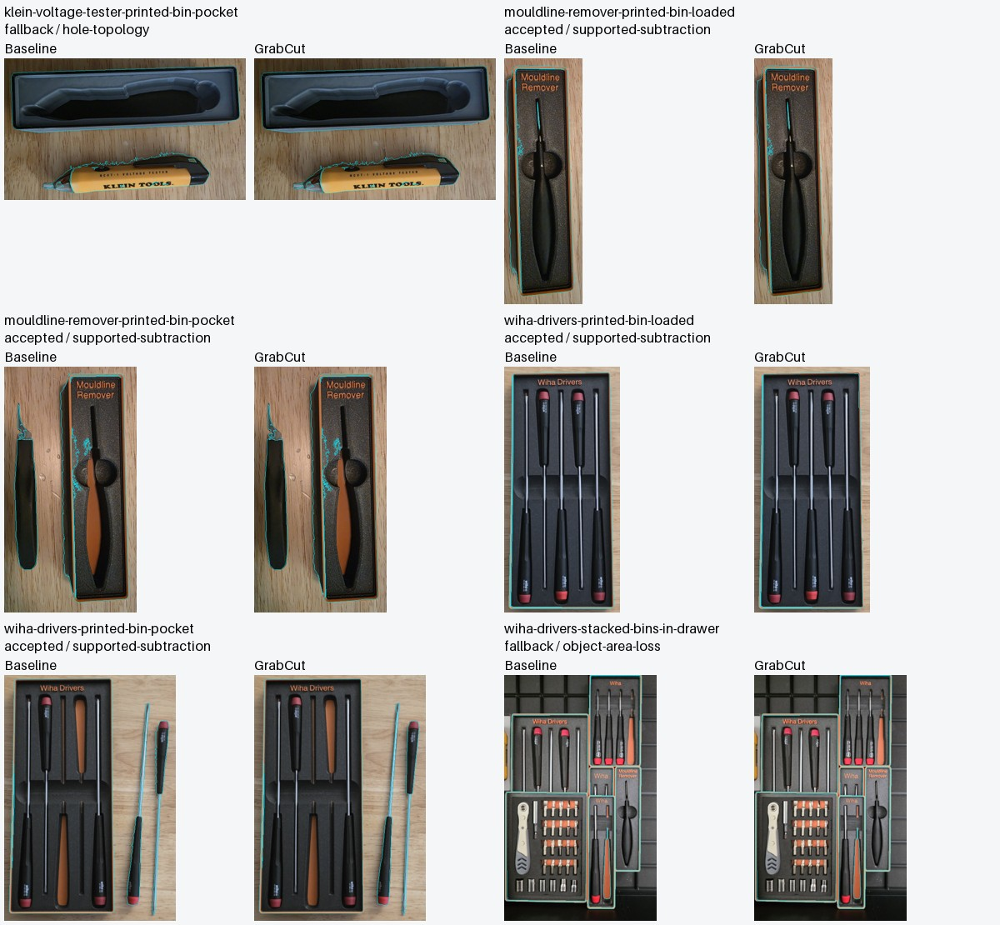
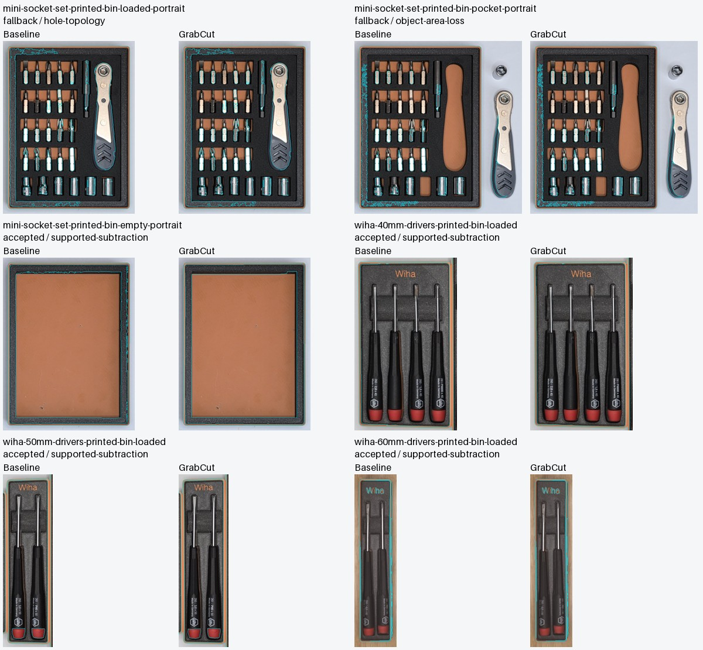
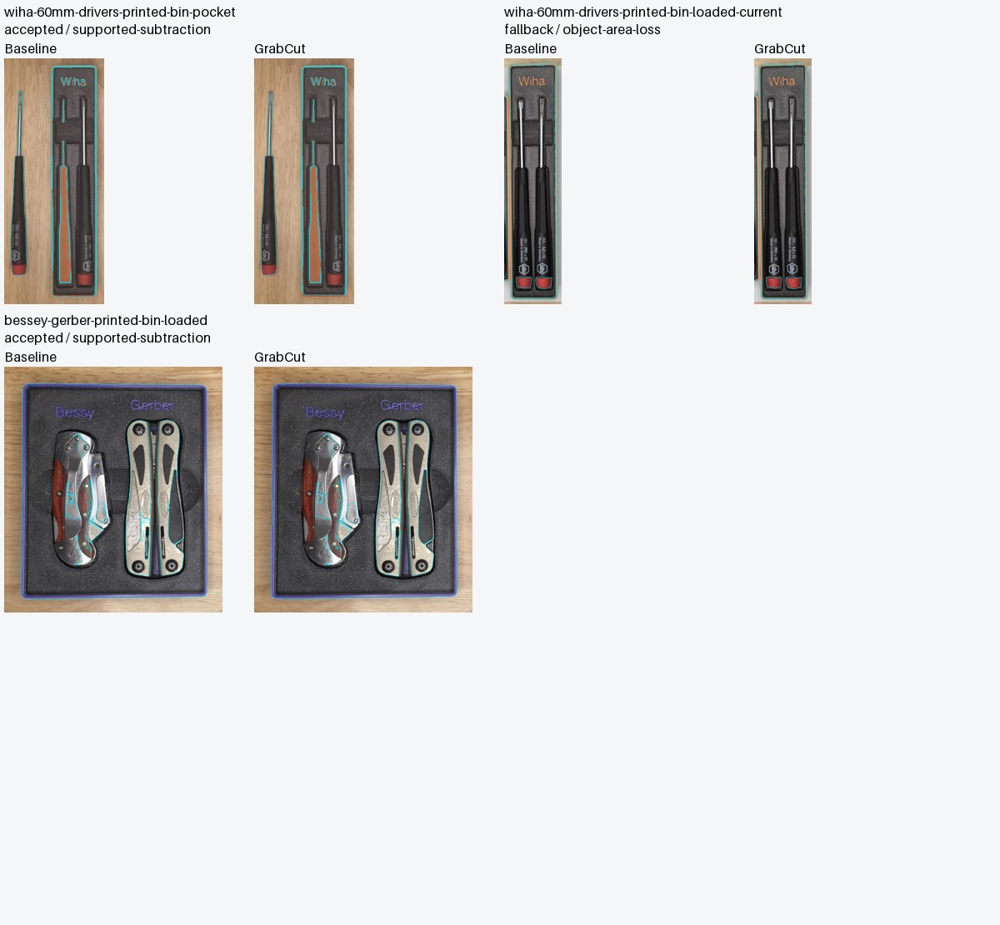

# Example-library GrabCut comparison — 2026-11-05

[Open/download the standalone visual report](report.html). Open the downloaded HTML in a browser: it contains **57 before/after pairs**, searchable by tool, photo set and acceptance/fallback. Cyan contours include shells and holes. “Hide outlines” reveals the original image evidence. It needs no server or network. The contact sheets below also render directly on GitHub.

## Coverage and method

All **27 distinct published photographs** from `samples/source-files.json` were tested, covering all 16 library entries (some entries share photos). In addition, Downloads supplied **19 ordinary tool-photo crops and 11 older checkerboard-background photos**. Filenames, original SHA-256, decoded RGBA SHA-256, working size, selected ROI and raw timing samples are in [benchmark.json](benchmark.json). Working copies were cached before the Downloads reorganization. The original photographs remain untouched.

This is complete coverage of the published library photos, **not verified recovery of every historical tracing source**. The sample projects do not retain their tracing images. Separate original DeWalt adapter and Klein tester photos were not identified in the searched Downloads files/archives; their published print photographs are included. Other associations are based on tool appearance, not a retained historical source link. The mini-socket sample uses a drawn rectangular recess.

Each input is EXIF-oriented, bilinear-resized within the existing 800×600 cap, then cropped to a recorded tool region (published and checkerboard cases use the full frame). Both methods receive identical pixels and default sensitivity/simplification. No per-photo tuning is used. The benchmark calls the actual production detector and shipped OpenCV 4.11 CPU/WASM. The after result includes the production acceptance guards and exact baseline fallback. Seven warmed runs per method alternate execution order; debug-image allocation is disabled during timing. First captures with debug are recorded separately and are not fresh-process cold-inference measurements. Python's decode/resample is controlled between methods but need not be bit-identical to each browser's canvas decoder.

## Boundary findings

- **Strong visible improvement:** close Gerber side-shadow removal, with both detected end recesses retained. The earlier sparse Gerber landmark check improved mean crossing error from 6.25 to 0.45 working pixels; its single-evaluator annotations have about ±1.5 px uncertainty and are not a full mask score.
- **Smaller gains:** nozzle side shadows, stapler, wire-stripper edges and early air-duster photos show limited trimming. Three tool crops change only 3–9 mask pixels.
- **Baseline failures remain:** faint caliper beams and several Wiha shafts are missing or fragmented; the Ryobi outline misses material. This conservative refinement cannot add foreground missing from the initial mask. False interior holes from reflections or lettering can remain when holes are enabled.
- **Fallback:** 20 of 57 proposals retain the exact original mask and outline, including 6 of the 19 ordinary tool crops. Rejection protects against damage; it is not an accuracy improvement.
- **Stress cases:** loaded/empty print photos often trace the bin or internal contrast instead of a complete tool. Older patterned mats compete with the tool as foreground. Their acceptance or smaller contours cannot establish tool-boundary accuracy.

Overall, 37 proposals were accepted. **Accepted does not mean improved.** Every case has a visual assessment in the report and [review-notes.json](review-notes.json). There are no full ground-truth masks and no library-wide accuracy percentage. The small-feature tests, Gerber landmarks and synthetic checks supplement visual review; unchanged topology alone cannot prove dimensional fidelity.

## Added CPU cost

Node 22.22.2, macOS arm64; these are local detector timings, **not browser or phone measurements**. Rows summarize the per-photo medians. “Extra” is the median of paired differences, which need not equal the difference of the two group medians. P95 is across per-photo median extra times, not a per-request latency percentile.

| Set | Cases | Accepted / fallback | Baseline → refined median | Median extra | Median ratio | P95 / maximum extra |
| --- | ---: | ---: | ---: | ---: | ---: | ---: |
| Tool crops | 19 | 13 / 6 | 7.8 → 45.1 ms | 37.3 ms | 5.39× | 139.3 / 172.8 ms |
| Patterned backgrounds | 11 | 6 / 5 | 51.7 → 261.3 ms | 199.8 ms | 5.18× | 256.7 / 258.3 ms |
| Published print photos | 27 | 18 / 9 | 40.0 → 215.7 ms | 175.5 ms | 5.65× | 314.9 / 319.4 ms |

The cost is material: ordinary crops are about 5.4× slower in this run, though their median total remains 45 ms. Larger full-frame cases cost hundreds of milliseconds. A worker protects UI responsiveness; it does not speed up GrabCut, and rejected candidates can still incur solver cost. The quality benefit varies substantially by photo.

OpenCV initialization across the three batch processes was 148.7–155.7 ms. WASM heap capacity stayed at **128 MiB**. Maximum sampled process RSS was **480.1 MiB**, and maximum sampled JS heap use was 153.9 MiB, including the benchmark harness, captures and accumulated results. These are samples, not an OS peak or incremental GrabCut memory measurement; the earlier five-photo OS peak and browser measurements remain in the [implementation evaluation](../../photo-refinement-evaluation.md). The existing main-thread calibration runtime may coexist with the worker's runtime.

The earlier application build comparison adds **13.8 KB gzip of JavaScript** across the loader/worker changes, with the existing self-hosted OpenCV runtime still about 3.86 MB gzip. There is no model, new inference runtime or GPU download. This HTML report is about 7.3 MB uncompressed because it embeds comparison images; documentation is not shipped as an application asset.

Earlier desktop checks cover installed Chrome/Edge in headless mode and native Safari, with sampled frame gaps of about 17–29 ms during worker detection. Those short runs predate the final thin-feature guard and are not a responsiveness benchmark of all 57 photos. No physical Windows PC, iPhone, iPad or Android testing was available. Mobile performance and memory remain unqualified; emulation is not substituted for device evidence.

## Validation and provenance

All 57 measured pairs passed mask dimensions, no foreground growth, equal output shell/hole counts, at most two solver iterations and exact fallback mask/outline checks: [validation.json](validation.json). Existing actual-WASM regression tests cover the Gerber recess, thin features, transparent alpha, ROI clipping, multiple objects, holes, solver failure, cancellation/superseding and resource cleanup. No example project, calibration, coordinate scale or export path was changed.

The rebased 1.7.0 PR branch passed `npm run check`, `npm test` (214 files, 3,416 tests), `npm run build` and `git diff --check`. Report checks confirmed all 27 published source hashes, 57 unique cases with notes, 114 panels and no external resources. Native Safari rendered the local HTML and exercised name filtering and the outline toggle. These are report checks, separate from detector browser benchmarks. Hosted CI remains disabled; no merge or deployment was performed.

No application dependency was added or changed; only application version metadata was bumped. Evaluation scripts use separately installed Pillow (HPND) and NumPy (BSD); their binaries are not redistributed. Published photographs retain the repository sample provenance. Additional tool photos were supplied through the maintainer's Downloads for this requested evaluation/PR; independent authorship/license verification was not performed. No third-party stock images, neural weights or converted graphs are included. Derived figures discard EXIF/GPS metadata. The [implementation evaluation](../../photo-refinement-evaluation.md) records OpenCV notices and TEED's provenance and rejected integration.

## Reproduction

Use Node 22 and the repository dependencies installed by `npm ci`, plus Pillow and NumPy in a separate Python environment. The scripts do not download anything. `--downloads` is optional; without it, only the 27 published photos run. Moved originals are searched recursively by filename; ambiguous distinct matches are reported missing.

```sh
python3 scripts/photo-evaluation/prepare-library.py --output /tmp/library-input --downloads /path/to/Downloads
node --import tsx scripts/evaluate-photo-library.ts /tmp/library-input/cases.json /tmp/library-results
python3 scripts/photo-evaluation/report-library.py /tmp/library-input /tmp/library-results /tmp/library-report/report.html --notes docs/photo-refinement-evaluation/library/review-notes.json
python3 scripts/photo-evaluation/render-library.py /tmp/library-input /tmp/library-results /tmp/library-report
```

The checked-in measurements combine an initial batch, additional recovered photos and two corrected air-duster selections; the final input ROIs are in the preparation script. Timings vary with system load and are not thresholds. Source files remain local; saved hashes make comparisons auditable after reorganization.

## Contact sheets

For each case, baseline is left and guarded GrabCut is right. Use the HTML for larger panels and individual notes. These are measured vector overlays, not generated illustrations.

### Tool photos and patterned-background cases











### All published library photographs











## Per-case timing and assessment

| Detection | Before → after (ms) | Result | Visual assessment |
| --- | ---: | --- | --- |
| [wolfbox-mf70-airduster-kit-printed-bin-loaded](report.html#wolfbox-mf70-airduster-kit-printed-bin-loaded) | 57.2 → 335.8 | accepted | Bin-edge cleanup |
| [wolfbox-mf70-airduster-kit-printed-bin-pocket](report.html#wolfbox-mf70-airduster-kit-printed-bin-pocket) | 46.6 → 304.5 | accepted | Print-photo stress case |
| [dewalt-right-angle-tools-printed-bin-loaded](report.html#dewalt-right-angle-tools-printed-bin-loaded) | 28.1 → 186.5 | accepted | Print-photo stress case |
| [ryobi-cutter-printed-bin-loaded](report.html#ryobi-cutter-printed-bin-loaded) | 42.2 → 271.6 | accepted | Print-photo stress case |
| [ryobi-cutter-printed-bin-pocket](report.html#ryobi-cutter-printed-bin-pocket) | 75.5 → 381.7 | accepted | Print-photo stress case |
| [caliper-storage-printed-bin-loaded](report.html#caliper-storage-printed-bin-loaded) | 34.6 → 258.6 | accepted | Print-photo stress case |
| [caliper-storage-printed-bin-pocket](report.html#caliper-storage-printed-bin-pocket) | 58.7 → 365.4 | fallback | Unchanged: fallback |
| [stapler-printed-bin-loaded](report.html#stapler-printed-bin-loaded) | 40.1 → 215.7 | fallback | Unchanged: fallback |
| [stapler-printed-bin-pocket](report.html#stapler-printed-bin-pocket) | 61.0 → 364.9 | fallback | Unchanged: fallback |
| [wire-strippers-printed-bin-loaded](report.html#wire-strippers-printed-bin-loaded) | 33.8 → 204.9 | accepted | Print-photo stress case |
| [wire-strippers-printed-bin-pocket](report.html#wire-strippers-printed-bin-pocket) | 22.4 → 168.7 | accepted | Print-photo stress case |
| [klein-voltage-tester-printed-bin-loaded](report.html#klein-voltage-tester-printed-bin-loaded) | 28.6 → 153.5 | fallback | Unchanged: fallback |
| [klein-voltage-tester-printed-bin-pocket](report.html#klein-voltage-tester-printed-bin-pocket) | 45.1 → 270.5 | fallback | Unchanged: fallback |
| [mouldline-remover-printed-bin-loaded](report.html#mouldline-remover-printed-bin-loaded) | 40.0 → 158.2 | accepted | Print-photo stress case |
| [mouldline-remover-printed-bin-pocket](report.html#mouldline-remover-printed-bin-pocket) | 58.9 → 260.8 | accepted | Background confusion remains |
| [wiha-drivers-printed-bin-loaded](report.html#wiha-drivers-printed-bin-loaded) | 24.6 → 139.2 | accepted | Print-photo stress case |
| [wiha-drivers-printed-bin-pocket](report.html#wiha-drivers-printed-bin-pocket) | 34.5 → 201.7 | accepted | Small cleanup |
| [wiha-drivers-stacked-bins-in-drawer](report.html#wiha-drivers-stacked-bins-in-drawer) | 31.4 → 158.8 | fallback | Unchanged: fallback |
| [mini-socket-set-printed-bin-loaded-portrait](report.html#mini-socket-set-printed-bin-loaded-portrait) | 98.3 → 392.5 | fallback | Unchanged: fallback |
| [mini-socket-set-printed-bin-pocket-portrait](report.html#mini-socket-set-printed-bin-pocket-portrait) | 142.4 → 460.8 | fallback | Unchanged: fallback |
| [mini-socket-set-printed-bin-empty-portrait](report.html#mini-socket-set-printed-bin-empty-portrait) | 52.0 → 268.8 | accepted | Bin-interior cleanup |
| [wiha-40mm-drivers-printed-bin-loaded](report.html#wiha-40mm-drivers-printed-bin-loaded) | 25.8 → 188.8 | accepted | Print-photo stress case |
| [wiha-50mm-drivers-printed-bin-loaded](report.html#wiha-50mm-drivers-printed-bin-loaded) | 17.0 → 96.9 | accepted | Print-photo stress case |
| [wiha-60mm-drivers-printed-bin-loaded](report.html#wiha-60mm-drivers-printed-bin-loaded) | 24.2 → 100.2 | accepted | Print-photo stress case |
| [wiha-60mm-drivers-printed-bin-pocket](report.html#wiha-60mm-drivers-printed-bin-pocket) | 28.4 → 144.2 | accepted | Print-photo stress case |
| [wiha-60mm-drivers-printed-bin-loaded-current](report.html#wiha-60mm-drivers-printed-bin-loaded-current) | 17.5 → 82.1 | fallback | Unchanged: fallback |
| [bessey-gerber-printed-bin-loaded](report.html#bessey-gerber-printed-bin-loaded) | 79.7 → 399.1 | accepted | Limited benefit |
| [airduster-nozzle](report.html#airduster-nozzle) | 7.8 → 45.1 | accepted | Visible cleanup |
| [airduster-body](report.html#airduster-body) | 13.4 → 80.6 | fallback | Unchanged: fallback |
| [airduster-pair](report.html#airduster-pair) | 26.0 → 161.5 | fallback | Unchanged: fallback |
| [airduster-angle-nozzle](report.html#airduster-angle-nozzle) | 8.2 → 68.1 | fallback | Unchanged: fallback |
| [ryobi-original](report.html#ryobi-original) | 13.1 → 89.0 | accepted | Limited benefit |
| [mouldline-original](report.html#mouldline-original) | 5.5 → 22.1 | accepted | Negligible change |
| [stapler-original](report.html#stapler-original) | 17.5 → 87.5 | accepted | Small cleanup |
| [caliper-original](report.html#caliper-original) | 4.6 → 25.3 | accepted | Baseline failure remains |
| [mouldline-distant](report.html#mouldline-distant) | 3.2 → 13.4 | fallback | Unchanged: fallback |
| [wiha-150-original](report.html#wiha-150-original) | 11.5 → 62.8 | accepted | Baseline failure remains |
| [bessey-original](report.html#bessey-original) | 4.9 → 20.5 | fallback | Unchanged: fallback |
| [gerber-close](report.html#gerber-close) | 30.0 → 202.7 | accepted | Visible improvement |
| [gerber-distant](report.html#gerber-distant) | 5.7 → 26.9 | fallback | Unchanged: fallback |
| [wiha-60-original](report.html#wiha-60-original) | 3.6 → 15.3 | accepted | Small change |
| [wiha-50-original](report.html#wiha-50-original) | 3.4 → 13.1 | accepted | Negligible change |
| [wiha-40-original](report.html#wiha-40-original) | 3.1 → 12.6 | accepted | Negligible change |
| [wire-strippers-original](report.html#wire-strippers-original) | 10.5 → 63.1 | accepted | Small cleanup |
| [airduster-body-early](report.html#airduster-body-early) | 11.8 → 63.3 | accepted | Small cleanup |
| [airduster-nozzle-early](report.html#airduster-nozzle-early) | 7.4 → 35.6 | accepted | Small cleanup |
| [caliper-mat-20260812_164339](report.html#caliper-mat-20260812_164339) | 70.6 → 293.2 | fallback | Background stress case |
| [caliper-mat-20260812_164350](report.html#caliper-mat-20260812_164350) | 102.7 → 361.1 | fallback | Background stress case |
| [caliper-mat-20260812_171044](report.html#caliper-mat-20260812_171044) | 30.5 → 224.4 | accepted | Background stress case |
| [caliper-mat-20260812_171049](report.html#caliper-mat-20260812_171049) | 72.3 → 327.4 | accepted | Background stress case |
| [caliper-mat-20260812_171808](report.html#caliper-mat-20260812_171808) | 37.9 → 217.5 | accepted | Background stress case |
| [caliper-mat-20260812_171814](report.html#caliper-mat-20260812_171814) | 51.7 → 267.9 | accepted | Background stress case |
| [wire-mat-20260812_173148](report.html#wire-mat-20260812_173148) | 61.5 → 261.3 | fallback | Background stress case |
| [wire-mat-20260812_173156](report.html#wire-mat-20260812_173156) | 70.0 → 295.5 | accepted | Background stress case |
| [wire-mat-20260817_124249](report.html#wire-mat-20260817_124249) | 37.6 → 229.4 | fallback | Background stress case |
| [wire-mat-20260817_124240](report.html#wire-mat-20260817_124240) | 37.0 → 218.7 | fallback | Background stress case |
| [wire-mat-20260817_124246](report.html#wire-mat-20260817_124246) | 36.5 → 218.4 | accepted | Background stress case |
