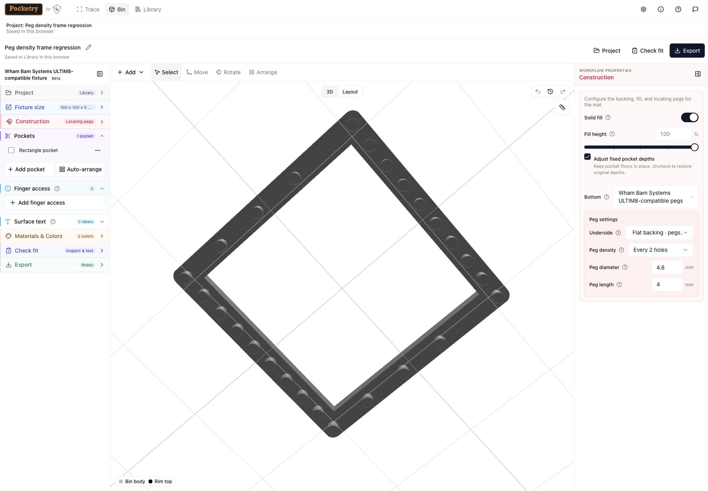
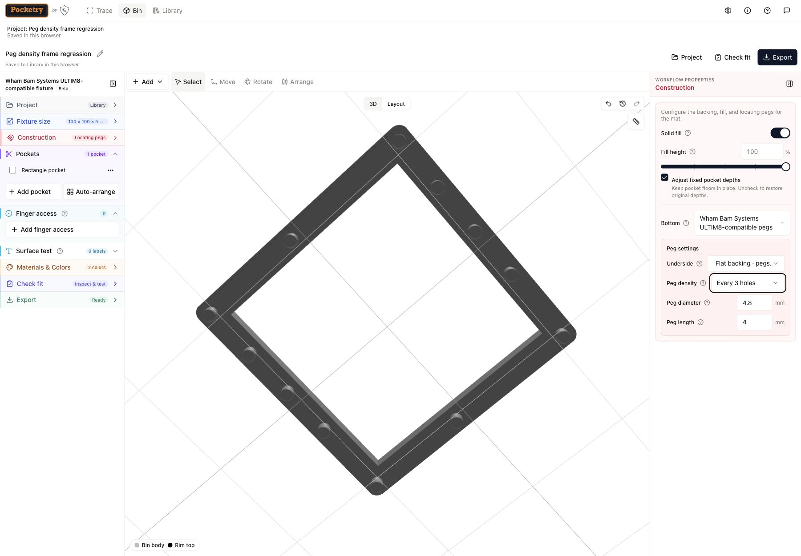

# Wham Bam Systems ULTIM8-compatible fixture entry

## Approach and state flow

- `spec.pegBottom` is the only fixture-profile signal, including old projects,
  imports, undo/redo, and visits to `/bin`. No mode field or schema migration.
- `/ultim8` and `/bin` render the same mounted designer. The entry waits for
  working-copy and library hydration. An existing peg project is retained exactly.
  Otherwise the existing `ProjectControls.createNewProject` path starts a fixture:
  a fresh empty profile starts immediately; named work uses the existing confirmation
  and save-before-replace transaction; unnamed work requires save/discard/cancel.
  Success or cancellation replaces the URL with `/bin`. Failure keeps the original
  design and the retryable prompt. The workspace registry stays unchanged.
- Extract a pure typed settings helper returning the spec and material patches
  used by both setup and entry. Preserve the dialog's reducer preview and original
  finger-access depth checks. Entry uses a 5 mm body thickness;
  both paths use flat backing, pegs-up export, default pegs, no lip, solid 100%,
  arbitrary rectangular dimensions, and one color. New entry projects start at
  100 × 60 × 5 mm; converting an existing project retains its dimensions. Custom legacy footprints keep
  their exact shape; opening a saved project never reapplies defaults.
- Peg controls are available whenever pegs exist; creation from a regular Bottom
  selector remains Experimental-only. Show a small Beta label. Wall slant, design links, and all other remaining experimental gates stay
  unchanged. Wall thickness is public following main’s tall-bin updates.
- `projectUsesExperimentalFeatures` currently has no production callers; only its
  unit tests and the experimental-provider test use it. Exclude pegs in current
  and historical snapshots because they no longer require opt-in tools. Keep
  other experimental detection intact. Remove pegs from the panel notice too.
- Reuse the existing panels with profile conditions and fixture wording. Display
  millimetres for legacy rectangular peg projects without mutation; a user size
  edit may explicitly convert to arbitrary dimensions. Custom footprints retain
  their stored geometry and expose their existing footprint editor in a collapsed
  legacy-shape section.
- Put the fixture empty-state hint and Trace action on the canvas, visible on
  desktop and phones: add object → set thickness → export fixture + alignment SVG.
  Keep Add pocket and all existing creation tools. Flush the current project before
  leaving for Trace; use the existing destination fingerprint/ID on handoff.
- Lead the existing export panel with fixture STL/3MF and 1:1 alignment SVG. Say
  pegs up only for flat backing; legacy sloped/bridged designs retain their actual
  orientation. Geometry and serializer behavior stay unchanged; SVG metadata uses
  the creator-qualified compatibility name.
- Skip the generic first-visit welcome for this entry so it cannot obscure the
  fixture start. Add linkable Help content, update the peg guide, README, changelog.
  Use Wham Bam Systems ULTIM8-compatible wording and retain the provenance and
  trademark attribution in NOTICE.

## Gridfinity-only control inventory

| Existing control | Fixture treatment |
| --- | --- |
| Grid pitch selector; full/half/quarter cells and size sliders | Hide for rectangular fixtures; width/length in mm instead |
| Height-unit slider and unit field | Body thickness in mm instead |
| Edit footprint / reset rectangle | Hide for rectangles; collapse together with cell-size explanation for legacy custom footprints |
| Stacking lip switch | Hide; retain existing saved lip geometry |
| Magnet holes, crush ribs, screw holes | Already hidden by smooth-base condition, retain that behavior |
| Label-tab shelf / wall / choose-edge controls | Hide for fixtures; retain any saved shelf geometry |
| Keep bin size fixed | Hide for fixtures; arbitrary sizes remain fixed |
| Gridfinity dimensions help and cell/unit summaries | Fixture dimensions, body thickness and peg extension wording |
| Bottom selector | Keep as explicit conversion back to a regular project; peg controls remain visible |

Solid fill, pocket depths, finger access, surface text, colors, fit checks,
arrangement, validation, and undo remain relevant and available. Navigation,
inspector headings, export descriptions, and model labels use fixture wording.

## Adversarial self-review and revisions before implementation

1. Hydration races could replace a real project with defaults. Gate entry on both
   hydration and library readiness, use one request per visit, and share one route
   component so replace navigation cannot remount and race an autosave.
2. An unnamed draft may contain only changed dimensions/colors/history. Reuse the
   existing comprehensive `hasDraftWork`, not just a pocket count. Await all saves;
   failed restore/save must prevent replacement. Cancel must retain the design.
3. A route effect could run twice in StrictMode or open two dialogs on a phone.
   Guard the request with a ref; keep the existing project controller mounted with a stable portal host while its panel section is closed. The first workflow run exposed that collapsed sections otherwise unmount it.
4. A fresh fixture could be lost on an immediate Trace click. Flush persistence
   before navigation and block navigation on a failed save. Verify the returning
   destination fingerprint and pegs, including unnamed fixtures.
5. A broad Experimental override would leak unrelated tools. Change only the peg
   control condition and peg-only notice/detection; test other gates with opt-in off.
6. Reapplying defaults to old projects would alter material partitions, dimensions,
   lips, and underside orientation. Apply defaults only at creation/explicit setup;
   test restored specs and export inputs for exact equality.
7. Hiding grid UI could strand custom footprints or confuse regular users. Keep
   legacy custom shape controls collapsed, preserve Bottom conversion, derive the
   profile immediately from the current spec (including undo), leave tabs unchanged.
8. The generic welcome would obscure the entry after URL replacement. Dismiss it
   for an explicit `/ultim8` visit using the existing welcome lifecycle.

## Test and delivery plan

- Pure defaults/immutability tests, plus dialog/entry equality and depth conflicts.
- Route workflows: fresh profile, saved peg project, named Gridfinity project,
  unnamed draft save/discard/cancel, failed save/restore, repeat entry, replaced
  history and Back; desktop/mobile and both existing panel layouts.
- Gate/profile assertions, legacy spec/export preservation, real Trace handoff
  into the same fixture; Help anchor and welcome behavior.
- Node 22: `npm run check && npm test`, all workflow tests for the shared page,
  relevant existing peg/export qualification, `npm run build`, `git diff --check`.
- Run localhost:5000 in a clean browser at desktop/mobile widths, create a pocket,
  export STL and alignment SVG, inspect files and capture screenshots for the PR.
- Small commits, Will Cobb as author, brief PR for human review; do not merge or
  run/enable GitHub CI.

## Follow-ups (out of scope)

Mat peg-field view; XL/MINI presets; xTool/Gweike/Morpho laser/UV mats (only
eufyMake E1 peg layout is validated); graduating other Experimental features;
analytics; server changes. Physical print and mat-fit qualification remain separate
from the browser/export checks in this change.

## Local verification — 2026-10-19

- Node 22: `npm run check` passed; `npm test` passed 200 files / 3,114 tests;
  `npm run test:workflows` passed 11 files / 467 tests.
- `npm run test:geometry -- peg-bottom.qualification` passed 31 tests, including
  legacy underside modes and pegs-up exports. `npm run build` and
  `git diff --check` passed. No geometry or serializer implementation changed.
- Clean task browser at `http://127.0.0.1:5000/ultim8`: entry replaced the URL
  with `/bin` with Experimental off. Tested 1440×1000 desktop and 390×844 mobile,
  changed body thickness to 8.5 mm, added a rectangle/circle pocket respectively,
  and downloaded STL plus alignment SVG at each width. Direct fixture Help link
  opened its section. The screenshots below were refreshed for the October 20
  defaults and branding refinements.
- Both downloaded STLs have positive signed volume, every edge shared by two
  triangles, bounds 83.5×83.5×12.5 mm with minimum Z=0. Both SVGs declare
  83.5×83.5 mm and include pocket openings plus four retained peg circles.
  [Export measurements and SHA-256 hashes](ultim8-entry-evidence/exports.json).
- Existing blind-pocket roof warning remains visible. These checks do not
  qualify slicer settings, physical print quality, or mat fit. GitHub CI remained
  disabled; no hosted verification was run.

## Refinements and verification — 2026-10-20

- New fixtures start at 100 × 60 mm with a 5 mm body; default pegs add 4 mm.
  Existing fixtures and explicit setup conversions keep their dimensions.
- User-facing compatibility names include Wham Bam Systems. The empty-state hint
  says “Locating pegs fit Wham Bam Systems ULTIM8 mat spacing.” The fixture size-lock
  toggle is hidden; arbitrary millimetre sizing remains fixed.
- Node 22: type check, 3,115 quick tests, 467 workflow tests, build, and whitespace
  checks passed. The 31 peg qualification tests also passed. No GitHub CI was run.
- At 1440×1000 and 390×844, verified the new defaults, wrapping of the full brand
  name, exact hint, and absent size-lock toggle. An existing 83.5×83.5×8.5 mm fixture
  stayed unchanged on entry before creating the fresh fixture.
- Added a circle pocket and downloaded STL plus SVG from the mobile export UI.
  The STL has 2,044 triangles, positive volume, every edge shared by two triangles,
  and 100×60×9 mm bounds with minimum Z=0. The SVG declares 100×60 mm, includes
  four retained peg circles, and uses the creator-qualified title.
  [Measurements and hashes](ultim8-entry-evidence/refinement-exports.json).
- The sample's 4 mm blind pocket leaves a 1 mm floor; both the thin-floor warning
  and pegs-up pocket-roof warning remain visible. Slicing, physical printing, and
  mat fit were not qualified.
- [Mobile dimension controls](ultim8-entry-evidence/mobile-size.png).

| Desktop entry and dimensions | Desktop export |
| --- | --- |
|  |  |

| Mobile entry | Mobile export |
| --- | --- |
|  |  |

## Peg-density correction — 2026-10-20

The reported through-opening frame exposes a phase problem: the centre-based
Every 2 pattern can miss surviving edge rows that Every 3 happens to include.
A 100×100 mm frame around an 80×80 mm through opening reproduces 4 versus 10 pegs.

Select corner anchors first, then repeatedly add the fitting mat hole farthest
from the existing pegs. Measure gaps in horizontal/vertical lattice pitches and
stop at the selected spacing. Every setting follows the same deterministic order,
so increasing density retains the sparser setting's positions. Numeric spacing
is approximate around openings and boundaries; keep all points on the unchanged
manufacturer lattice. Corners only, Every hole, and upright undersides stay exact.

Adversarial checks: preserve all corner anchors, exclude through-overlapped
shafts before selection, keep selection pure and stable, assert nested sets across
all densities on rectangular/custom footprints and removed-hole patterns, and
compare preview/export shaft slices against alignment SVG circles. Existing saved
numeric-density fixtures may redistribute pegs; regenerate their alignment SVG
with the fixture. No new stored fields or schema changes are needed.

The selector uses one distance array and updates it per added peg. The final
implementation's median across five local runs was 70.4 ms for all five numeric
settings on the maximum 671.5 mm square (8,845 fitting holes), and 0.5 ms for a
100 mm square. These are local measurements, not a performance guarantee.

- Integrated current main's size/wall controls while retaining fixture dimensions,
  public peg controls, and the existing project transaction behavior.
- Node 22: `npm run check`, `npm test` (3,157), `npm run test:workflows` (477),
  `npm run test:geometry -- peg-bottom.qualification tall-bin.qualification` (43),
  `npm run build`, and `git diff --check` passed. GitHub CI remained disabled.
- The synthetic frame reproduces the reported opening/edge interaction; it is not
  the user's exact traced outline. At Every 2 it now has 26 pegs versus Every 3's
  12. Every 3's positions are a subset of Every 2's. Corners/5/4/3/2/1 counts are
  4/6/12/12/26/36, checked at preview and export quality against SVG positions.
- Browser verification at 1440×1000 confirmed both selections. Downloaded STLs
  have 26 and 12 separate shaft cross-section loops, respectively, matching their
  alignment SVG circles. Both are closed with positive volume and 100×100×9 mm
  bounds, with minimum Z=0. [Measurements and hashes](ultim8-entry-evidence/density-exports.json).
  [Editable regression fixture](ultim8-entry-evidence/density-frame.pocketry.json).
  Physical printing, stiffness, and mat fit remain unverified.

| Every 2 holes: 26 pegs | Every 3 holes: 12 pegs |
| --- | --- |
|  |  |
