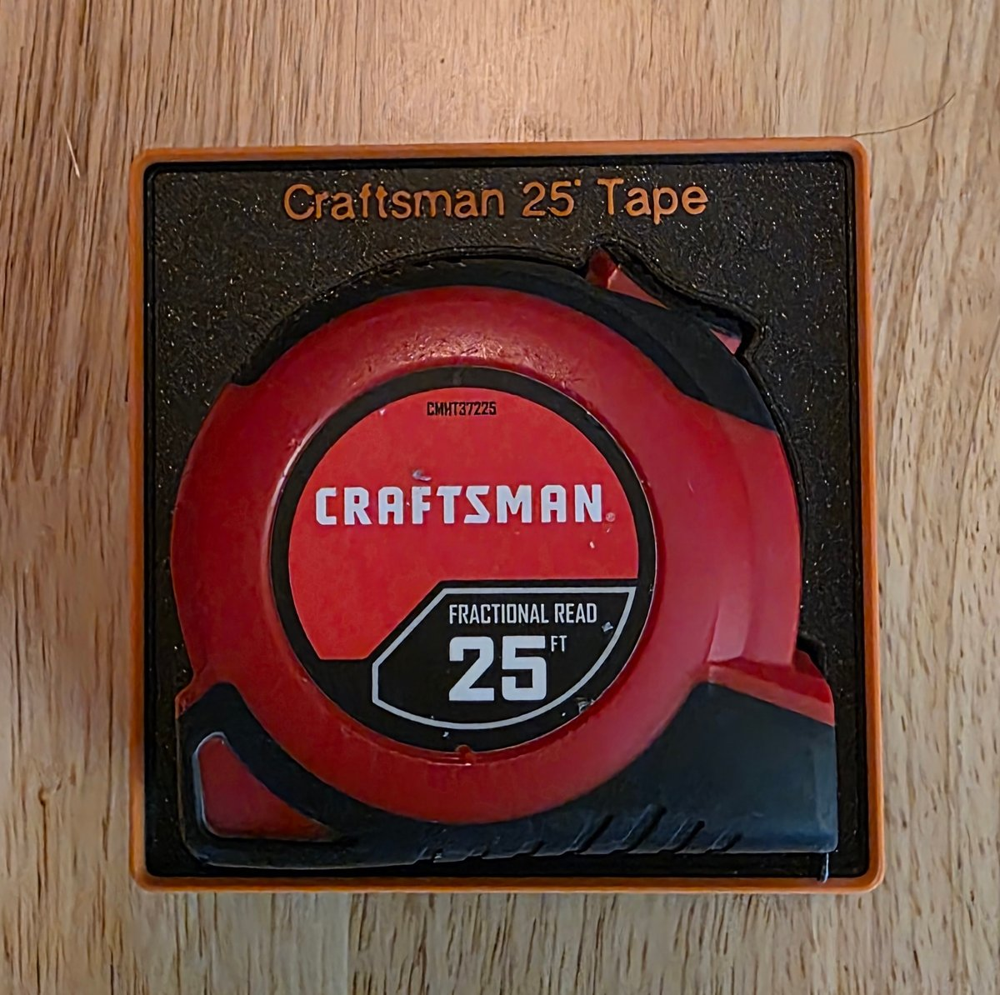
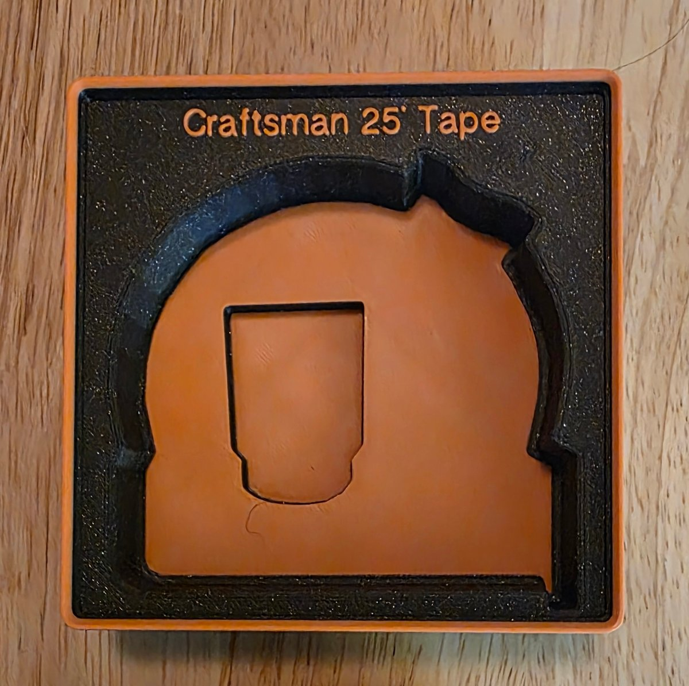
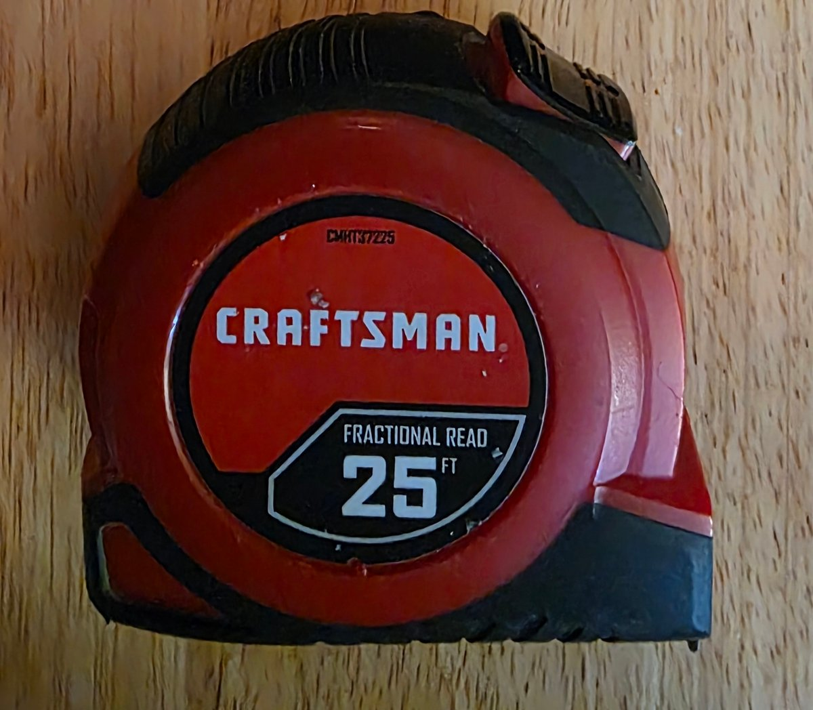
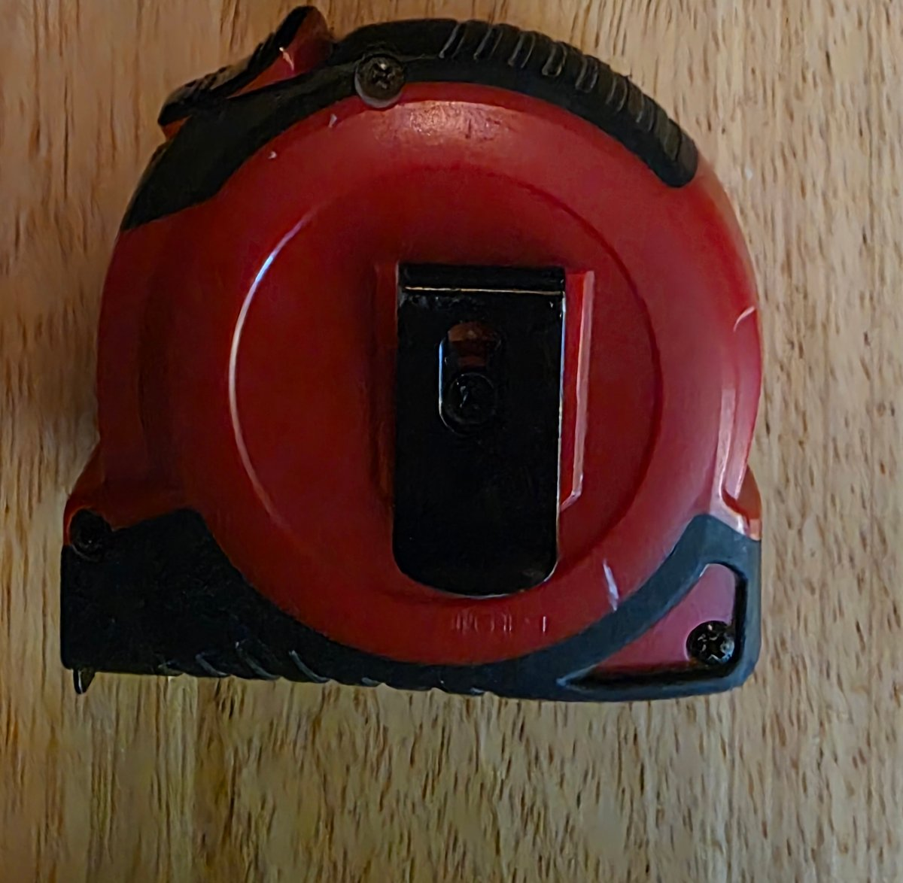

# Craftsman 25' tape measure

A fitted bin with a 16 mm-deep pocket for the tape measure body and a deeper
22 mm relief for its belt clip. The editable project includes the raised
“Craftsman 25' Tape” label and the original gray-and-black material colors.

- **Size:** 5 × 5 half-pitch; 4.5u. Grid cells are 21 mm, giving a 105 × 105 mm nominal footprint; one height unit is 7 mm, before the stacking lip.
- **Base:** Gridfinity, with a standard stacking lip.
- **Print model:** [craftsman-tape-measure.3mf](craftsman-tape-measure.3mf).
- **Editable project:** [craftsman-tape-measure.pocketry.json](craftsman-tape-measure.pocketry.json).

[How to open, edit, and print](../README.md#using-a-sample).

The 3MF is the original multicolor export from October 17, 2026. The editable
project comes from the matching export, migrated to the current format with
unused shapes and editing history removed. The photographed print uses orange
and black filament; the supplied project and 3MF retain their original gray
and black color assignments. Check dimensions and fit for your tape measure
before printing.

## Printed bin and tape measure

The top row shows the finished print with the tape measure seated, then the
empty pocket and its deeper belt-clip relief. The bottom row shows both sides
of the tape measure outside the bin.

<table>
  <tr>
    <td align="center"> Loaded bin</td>
    <td align="center"> Empty pocket</td>
  </tr>
  <tr>
    <td align="center"> Front of tape measure</td>
    <td align="center"> Belt-clip side</td>
  </tr>
</table>

[All samples](../README.md)
