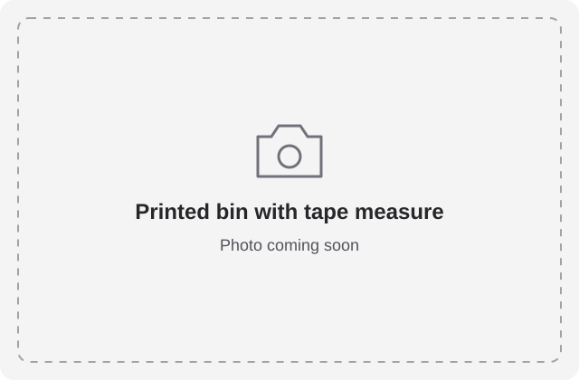
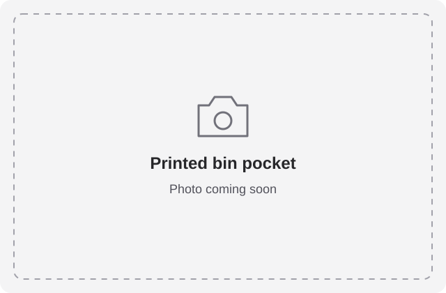

# Craftsman 25' tape measure

A fitted bin with a 16 mm-deep pocket for the tape measure body and a deeper
22 mm relief for its belt clip. The editable project includes the raised
“Craftsman 25' Tape” label and the original gray-and-black material colors.

- **Size:** 5 × 5 half-pitch; 4.5u. Grid cells are 21 mm, giving a 105 × 105 mm nominal footprint; one height unit is 7 mm, before the stacking lip.
- **Base:** Gridfinity, with a standard stacking lip.
- **Print model:** [craftsman-tape-measure.3mf](craftsman-tape-measure.3mf).
- **Editable project:** [craftsman-tape-measure.pocketry.json](craftsman-tape-measure.pocketry.json).

[How to open, edit, and print](../README.md#using-a-sample).

The 3MF is the original multicolor export from October 17, 2026. The editable
project comes from the matching export, migrated to the current format with
unused shapes and editing history removed. Check dimensions and fit for your
tape measure before printing.

## Printed bin

Printed-design photos will be added here when available. These placeholders
reserve views of the loaded bin and the empty pocket; they are not print photos.

<!-- Replace the placeholders with photos/printed-bin-loaded.jpg and
photos/printed-bin-pocket.jpg, update the catalog thumbnail, and record the
photo provenance and hashes in ../source-files.json when the photos arrive. -->

[All samples](../README.md)
